# Mercat-Conect · Arquitectura

> Documento de diseño técnico. Versión 0.3 · 15 de octubre de 2026 · Borrador para revisión del equipo.
>
> Los diagramas están en [Mermaid](https://mermaid.js.org/): GitHub los renderiza directamente al abrir este archivo.
> Las cifras marcadas como **supuesto** son hipótesis de trabajo que hay que validar. Lo marcado con **(verificar)** son afirmaciones externas (legales, de plataformas o de proveedores) que conviene confirmar antes de basarse en ellas.

**Cambios de la v0.3 respecto a la v0.2:**

| Tema | v0.2 | v0.3 (esta versión) |
|---|---|---|
| Canal de compra | Telegram (bot + Mini App) | **App web / PWA**: una sola interfaz, con *dashboard* de ofertas al estilo Too Good To Go |
| Telegram | Canal principal | **Opcional y futuro**: solo para enviar avisos (si sobra tiempo) |
| Identidad | Cuenta de Telegram + verificación de edad | Cuenta propia (correo) + verificación de edad |
| Contexto | Producto real | **Hackathon**: demo reproducible en `localhost` con datos inventados |
| Servicios externos | Reales | Detrás de interfaces, con **implementación simulada** para la demo |
| Notificaciones | Cola con límite de Telegram | Avisos en la app, correo y Web Push; Telegram como extra |

## Índice

1. [Resumen y principios de diseño](#1-resumen-y-principios-de-diseño)
2. [Alcance: hackathon y producto](#2-alcance-hackathon-y-producto)
3. [Requisitos](#3-requisitos)
4. [Visión de contexto](#4-visión-de-contexto)
5. [Arquitectura de componentes](#5-arquitectura-de-componentes)
6. [La aplicación web (PWA)](#6-la-aplicación-web-pwa)
7. [Identidad, mayoría de edad y una persona = una cuenta](#7-identidad-mayoría-de-edad-y-una-persona--una-cuenta)
8. [Modelo de datos](#8-modelo-de-datos)
9. [Ciclos de vida (máquinas de estado)](#9-ciclos-de-vida-máquinas-de-estado)
10. [Precios, restricciones y sistema de puntos](#10-precios-restricciones-y-sistema-de-puntos)
11. [Flujo de compra de extremo a extremo](#11-flujo-de-compra-de-extremo-a-extremo)
12. [Pagos](#12-pagos)
13. [Taquillas refrigeradas](#13-taquillas-refrigeradas)
14. [Notificaciones](#14-notificaciones)
15. [Envíos a domicilio (futuro)](#15-envíos-a-domicilio-futuro)
16. [Pipeline de datos](#16-pipeline-de-datos)
17. [Demo reproducible en localhost](#17-demo-reproducible-en-localhost)
18. [Seguridad, privacidad y cumplimiento](#18-seguridad-privacidad-y-cumplimiento)
19. [Infraestructura y despliegue](#19-infraestructura-y-despliegue)
20. [Observabilidad, SLOs y modos de fallo](#20-observabilidad-slos-y-modos-de-fallo)
21. [Estructura del repositorio y pruebas](#21-estructura-del-repositorio-y-pruebas)
22. [Hoja de ruta](#22-hoja-de-ruta)
23. [Riesgos](#23-riesgos)
24. [Decisiones abiertas](#24-decisiones-abiertas)

---

## 1. Resumen y principios de diseño

**Qué es.** Una plataforma pública donde los productores de los mercados municipales de València publican el excedente del día con el precio que ellos decidan, y vecinos mayores de edad lo compran desde una **app web** (instalable como PWA) y lo recogen en **taquillas refrigeradas**.

**Qué es hoy el proyecto.** Un proyecto de hackathon. El objetivo inmediato es una **demo reproducible en `localhost`** con datos inventados (sección 17) que enseñe el recorrido completo: dashboard → compra con puntos → preparación del productor → taquilla → impacto medido. La arquitectura está pensada para ese objetivo **y** para poder crecer hacia un producto real sin rehacerla.

**Principios** (cuando haya dudas, decide el que esté más arriba):

1. **Seguridad alimentaria primero.** Nada sale a la venta sin una cadena de frío demostrable (sensores, registros). En la demo se simula, pero el diseño la exige.
2. **Una fuente de verdad transaccional.** Stock, puntos y pagos cambian de forma atómica en una única base de datos. Nada de consistencia "eventual" en dinero ni en inventario.
3. **Todo lo externo detrás de una interfaz.** Verificación de edad, pagos, taquillas, envíos, notificaciones y reloj tienen una interfaz con **dos implementaciones**: la simulada (demo) y la real (producción). Es lo que hace posible una demo que funcione sin internet y, a la vez, no obliga a reescribir nada después.
4. **Reglas como datos, no como código.** Precios, puntos y restricciones se configuran y se versionan; no se programan caso por caso.
5. **Mínimo de datos personales.** Se guarda "mayor de edad verificado: sí/no, cuándo y cómo"; nunca la imagen del DNI.
6. **Monolito modular.** Un equipo pequeño se beneficia de tener poco que operar. Se separa solo lo que tiene motivos reales (el gateway de taquillas y el pipeline analítico, y aun así pueden ir en el mismo proceso en la demo).
7. **Todo deja rastro.** Cada cambio relevante emite un evento inmutable. De ahí salen la auditoría, las métricas y los datos abiertos.
8. **El tiempo es una dependencia.** Las reglas dependen de la hora del día; por eso toda la lógica usa un **reloj inyectable** (en la demo se puede adelantar a voluntad).

---

## 2. Alcance: hackathon y producto

### 2.1 Prioridades de la demo (MoSCoW)

| Prioridad | Qué entra |
|---|---|
| **Debe** | Arranque con un solo comando · datos inventados deterministas · *dashboard* de ofertas estilo Too Good To Go · detalle de oferta · registro/login con verificación de edad simulada · compra con **puntos** y **stock atómico** · pedido con código de retirada · panel del productor (publicar y preparar) · **taquilla simulada** · **reloj de demo** · al menos 2 reglas dinámicas visibles · panel de impacto con kg rescatados |
| **Debería** | **Simulador de demanda** (para ver cómo reaccionan las reglas) · donación del sobrante al cierre · avisos en la app en tiempo real · castellano y valenciano · PWA instalable · exportación CSV de datos abiertos · una prueba extremo a extremo del recorrido principal |
| **Podría** | Web Push real · correo (capturado en local con Mailpit) · mapa · código QR · Metabase · difusión a un canal de Telegram |
| **No en el hackathon** | Pagos reales · verificación de identidad real · hardware real · envíos · modelos de predicción · bot de Telegram completo |

### 2.2 Qué es real y qué se simula

Es importante ser claros ante un jurado: la demo **funciona de verdad** en lo que es lógica propia y **simula** lo que depende de terceros o de hardware.

| Pieza | En la demo | En producción |
|---|---|---|
| Dashboard, compra, reservas de stock, puntos, reglas dinámicas, estados de pedido | **Real** (el mismo código) | Igual |
| Base de datos y eventos | **Real** (PostgreSQL) | Igual |
| Pipeline de métricas e impacto | **Real**, a escala reducida | Igual, con más fuentes |
| Verificación de edad | **Simulada** (pantalla "Cl@ve de mentira") | Cl@ve / cartera europea / proveedor |
| Pago | **Simulado** (aprueba o falla a voluntad) | Pasarela con reparto a vendedores |
| Taquillas | **Simuladas** (página con puertas y termómetros) | Hardware con MQTT |
| Avisos | En la app (+ correo local opcional) | + Web Push, + correo real, + Telegram opcional |
| Datos de mercados, puestos, usuarios y ventas | **Inventados** (con nombres de mercados reales y puestos ficticios) | Datos reales |
| Reloj | **Controlable** | Hora real |

> Para el pitch: cifras de contexto solo con fuente (ver `docs/fuentes`). **No** presentar como dato el "4 %" de desperdicio en los mercados municipales: no hemos encontrado una fuente que lo respalde.

---

## 3. Requisitos

### 3.1 Funcionales

| ID | Requisito |
|---|---|
| RF-01 | El productor publica una oferta (producto, cantidad, **precio libre**, ventana de recogida) en menos de 30 segundos desde el móvil. |
| RF-02 | El productor define restricciones sobre su oferta (máximo por persona, coste en puntos, franjas) y puede elegir un perfil predefinido. |
| RF-03 | El sistema **ajusta las restricciones** de forma dinámica según demanda y hora del día, dentro de los límites que fijó el productor y el Ayuntamiento. |
| RF-04 | Cada usuario dispone de **puntos semanales**; cada compra consume puntos. Sin puntos suficientes no se puede comprar. |
| RF-05 | Solo pueden tener cuenta y comprar **mayores de 18 años verificados**. |
| RF-06 | El vecino ve un *dashboard* de ofertas (filtros, orden, cierre próximo) y compra **dentro de la app**. |
| RF-07 | Tras el pago, el productor prepara el pedido y lo deja en una **taquilla refrigerada**; el comprador recibe un código para abrirla. |
| RF-08 | El usuario recibe avisos de ofertas que le interesan (mercado, categorías, franja) en la app. |
| RF-09 | Lo que no se vende ni se recoge se ofrece a entidades sociales. |
| RF-10 | El Ayuntamiento gestiona altas de puestos, parámetros globales y consulta métricas. |
| RF-11 | (Futuro) Avisos por Telegram. |
| RF-12 | (Futuro) Envío a domicilio con un proveedor privado desde las taquillas. |
| RF-D1 | **La demo se arranca con un solo comando, sin internet, y siempre parte del mismo estado.** |
| RF-D2 | **La demo tiene un panel para controlar el reloj, simular demanda y reiniciar los datos.** |

### 3.2 No funcionales

| ID | Requisito | Objetivo |
|---|---|---|
| RNF-01 | Sin sobreventa de stock ni gasto de puntos por encima del saldo | 0 casos (lo garantiza la base de datos) |
| RNF-02 | Latencia de reserva | p95 < 500 ms |
| RNF-03 | El dashboard refleja cambios de stock | < 3 s (por *streaming* del servidor) |
| RNF-04 | Disponibilidad en horario de mercado (10:00–15:00) | ≥ 99,5 % (producción) |
| RNF-05 | Apertura de taquilla con la red caída | Debe funcionar offline durante la ventana del pedido |
| RNF-06 | RGPD, accesibilidad, castellano y valenciano | Obligatorio |
| RNF-07 | Software abierto (licencia EUPL) y datos abiertos agregados | Obligatorio |
| RNF-08 | Demo: arranque en frío | < 3 minutos en un portátil corriente (**supuesto**) |
| RNF-09 | Demo: determinismo | Mismos datos y mismo guion en cualquier máquina |

### 3.3 Supuestos de carga de producción (**supuesto**)

- 300 puestos, 100 publican a diario; 10 000 usuarios activos al mes.
- Pico de compras: ~200 pedidos en 10 minutos (≈ 0,3 pedidos/s). Una instancia de PostgreSQL basta con holgura.
- Con la app web **no hay un límite de tasa de terceros** como el de un bot: los avisos dentro de la app se entregan por *streaming* y no compiten por una cuota.

---

## 4. Visión de contexto

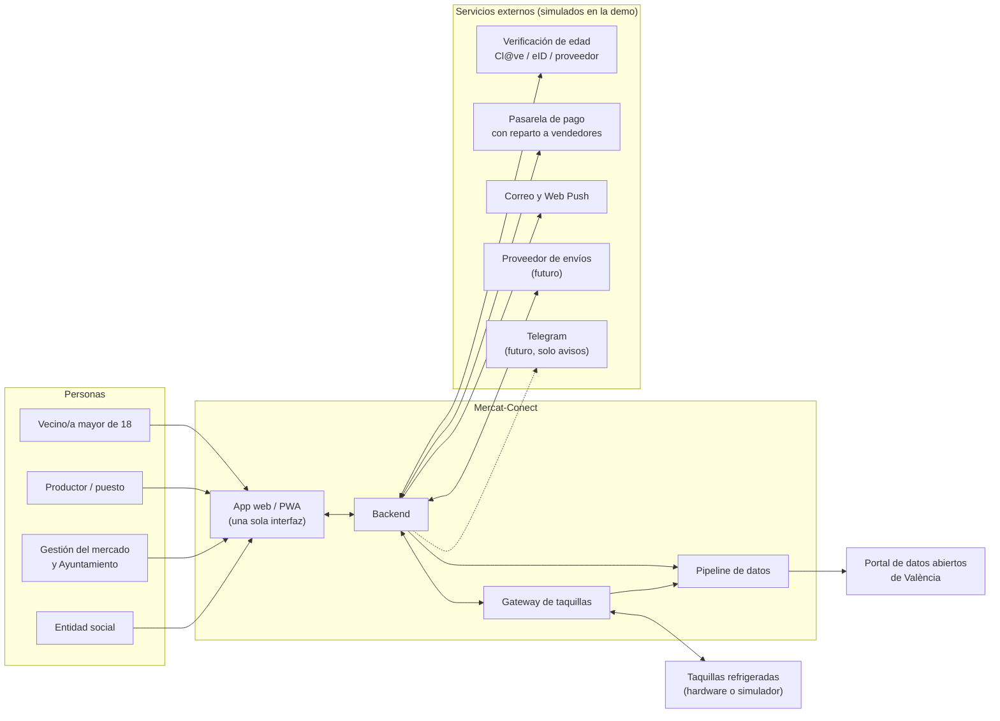

---

## 5. Arquitectura de componentes

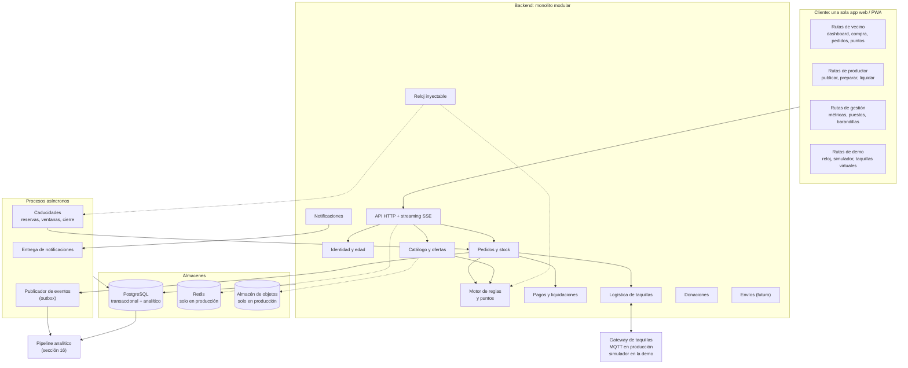

### 5.1 Responsabilidad de cada módulo

| Módulo | Responsabilidad | Datos que posee |
|---|---|---|
| **Identidad y edad** | Cuentas, sesiones, verificación de edad, una cuenta por persona | `users`, `user_identities` |
| **Catálogo y ofertas** | Puestos, productos, publicación y ciclo de la oferta | `stalls`, `products`, `offers` |
| **Motor de reglas y puntos** | Decidir si un usuario puede comprar, cuánto y a qué coste en puntos | `offer_policies`, `points_week`, `points_ledger` |
| **Pedidos y stock** | Reserva atómica de stock y puntos, estados del pedido | `orders`, `order_items` |
| **Pagos y liquidaciones** | Cobro, reembolsos y reparto al productor | `payments`, `payouts` |
| **Logística de taquillas** | Asignar compartimento, códigos, depósitos y retiradas | `lockers`, `compartments`, `deposits` |
| **Notificaciones** | Qué usuarios reciben qué aviso, por qué canal | `subscriptions`, `notifications`, `push_subscriptions` |
| **Donaciones** | Ofrecer el sobrante a entidades al cierre | `donations`, `charities` |
| **Envíos** | Interfaz con el proveedor privado (futuro) | `deliveries` |
| **Reloj** | Hora actual para toda la lógica (real o de demo) | (configuración) |

### 5.2 Perfil de demo frente a perfil de producción

El mismo código arranca en dos perfiles según variables de entorno.

| Componente | Perfil `demo` | Perfil `producción` |
|---|---|---|
| Base de datos | PostgreSQL en contenedor | PostgreSQL gestionado |
| Colas y planificación | Procesos internos del backend (sin Redis) | Redis (Streams) y workers separados |
| Fotos | Imágenes locales incluidas en el repo | Almacén de objetos S3-compatible |
| `AgeVerifier` | `FakeAgeVerifier` | Cl@ve / eID / proveedor |
| `PaymentProvider` | `FakePaymentProvider` | Pasarela real |
| `LockerTransport` | `InProcessSimulator` | `MqttTransport` |
| `Notifier` | En la app (SSE) + correo local | + Web Push + correo real (+ Telegram) |
| `Clock` | `DemoClock` (controlable) | `SystemClock` |
| Analítica | Vistas SQL y panel de impacto propio | dbt + Metabase |

> **Salvaguarda:** el backend **se niega a arrancar** en perfil `demo` si no está en `localhost`. Evita que una demo con pago falso y verificación falsa llegue por error a un entorno público.

### 5.3 Decisión de stack

| Capa | Elección propuesta | Alternativa | Motivo |
|---|---|---|---|
| Backend | **Python**: FastAPI + SQLAlchemy + Alembic | TypeScript: Fastify / NestJS | Mismo lenguaje que el pipeline de datos y los posibles modelos; el equipo ya trabaja en Python |
| Frontend | **React + Vite + TypeScript**, `vite-plugin-pwa`, i18n (es/va) | Svelte | Ecosistema amplio, componentes accesibles, una sola base para web y PWA |
| Estilos | Tailwind CSS + componentes accesibles (Radix UI) | CSS modular | Velocidad en un hackathon sin sacrificar accesibilidad |
| Tiempo real | **Server-Sent Events (SSE)** | WebSockets | Solo hace falta servidor → cliente; SSE es más simple y atraviesa proxies sin problemas |
| Base de datos | **PostgreSQL 16** | | Transacciones, `JSONB` para reglas |
| Telemetría (producción) | TimescaleDB (extensión de PostgreSQL) | InfluxDB | Un solo motor de base de datos |
| Mensajería IoT (producción) | MQTT sobre TLS (Mosquitto / EMQX) | HTTP | Estándar para dispositivos |
| Transformaciones (producción) | dbt + SQL | Pandas | Linaje y pruebas de calidad |
| Métricas (producción) | Metabase | Grafana | Lo puede usar gente no técnica |
| Demo | Docker Compose + `Makefile` | Scripts sueltos | Reproducibilidad |
| Pruebas | pytest, Hypothesis, Playwright | | Ver sección 21 |

> La elección Python/TypeScript no cambia la arquitectura. Si el equipo domina más TypeScript, todo lo de este documento se traslada igual.

### 5.4 Contrato de API (mínimo)

Sirve para repartir el trabajo entre frontend y backend desde el primer día. `Idempotency-Key` es obligatoria en las operaciones que crean pedidos.

| Método y ruta | Rol | Función |
|---|---|---|
| `POST /auth/register` · `/auth/login` · `/auth/logout` | público | Alta, entrada y salida (sesión por *cookie* `HttpOnly`) |
| `GET /identity/age/start` · `/identity/age/callback` | vecino | Inicio y resultado de la verificación de edad |
| `GET /offers?market=&category=&sort=&q=` | público | Listado para el dashboard (lectura anónima permitida) |
| `GET /offers/{id}` | público / vecino | Detalle; si hay sesión, incluye la **decisión del motor para ti** (coste en puntos, máximo, motivo) |
| `POST /orders` | vecino | Crea el pedido (reserva stock y puntos) |
| `POST /orders/{id}/pay` | vecino | Inicia el pago |
| `POST /payments/webhook/{provider}` | pasarela | Confirmación de pago (firma verificada) |
| `GET /orders` · `GET /orders/{id}` | vecino | Pedidos; el código de retirada solo se muestra en `IN_LOCKER` |
| `GET /me/points` | vecino | Saldo y fecha de renovación |
| `GET /notifications` · `POST /push/subscribe` | vecino | Bandeja y suscripción a Web Push |
| `GET /stream` | autenticado | SSE: `offer.updated`, `order.updated`, `notification.created` |
| `POST /producer/offers` · `PATCH /producer/offers/{id}` | productor | Publicar y editar |
| `POST /producer/offers/{id}/withdraw` | productor | Retirar |
| `GET /producer/orders` · `POST /producer/orders/{id}/accept` · `/deposit` | productor | Preparar y depositar |
| `GET /producer/payouts` | productor | Liquidaciones |
| `GET /admin/metrics` · `PUT /admin/guardrails` · `POST /admin/stalls` | gestión | Métricas, barandillas, altas |
| `GET /open-data/*.csv` | público | Datos abiertos agregados |
| `POST /demo/clock` · `/demo/simulate` · `/demo/reset` | **solo demo** | Reloj, demanda sintética, reinicio |
| `GET/POST /sim/lockers/*` | **solo demo** | Taquillas virtuales |

---

## 6. La aplicación web (PWA)

### 6.1 Una interfaz, varios roles

La "app" es **la misma web**: un único front responsive que se puede **instalar como PWA** (icono en el móvil, pantalla completa, avisos). No hay dos bases de código que mantener. Las rutas cambian según el rol de la cuenta.

| Zona | Ruta | Contenido |
|---|---|---|
| Vecino | `/` | **Dashboard de ofertas** |
| | `/oferta/:id` | Detalle y compra |
| | `/pedidos`, `/pedidos/:id` | Pedidos y código de retirada |
| | `/puntos`, `/perfil`, `/verificar-edad` | Saldo, ajustes, verificación |
| Productor | `/productor/publicar` | Publicar en < 30 s |
| | `/productor/pedidos` | Pedidos por preparar y depositar |
| | `/productor/ofertas`, `/productor/liquidaciones` | Gestión y cobros |
| Gestión | `/admin/*` | Métricas, puestos, barandillas, donaciones |
| Demo | `/demo`, `/sim/taquillas` | Reloj, simulador de demanda, taquillas virtuales |

### 6.2 Dashboard del vecino

Layout de tarjetas al estilo Too Good To Go: lo primero que se ve es **qué hay hoy, cuánto cuesta, cuánto queda y hasta cuándo**.

```
┌──────────────────────────────────────┐
│ Mercat-Conect          14 pts   [≡]  │
│ Mercat de Russafa  v     [Mapa|Lista]│
│ [ Buscar producto o puesto        ]  │
│ (Todo)(Fruta)(Verdura)(Pescado)(...) │
├──────────────────────────────────────┤
│ Cierran pronto                       │
│ ┌─────────┐ ┌─────────┐ ┌─────────┐  │
│ │  foto   │ │  foto   │ │  foto   │  │
│ │Tomates  │ │Naranjas │ │Merluza  │  │
│ │2,50 EUR │ │1,00 EUR │ │6,00 EUR │  │
│ │ Quedan 3│ │ Quedan 8│ │ Quedan 2│  │
│ │ 25 min  │ │ 40 min  │ │ 55 min  │  │
│ └─────────┘ └─────────┘ └─────────┘  │
├──────────────────────────────────────┤
│ Cerca de ti              Ordenar: v  │
│ ┌──────────────────────────────────┐ │
│ │ [foto]  Puesto de Pepa           │ │
│ │         Verdura de temporada     │ │
│ │         2,50 EUR  (antes 5,00)   │ │
│ │         Recoge hoy 13:30-14:30   │ │
│ │         Quedan 3 · Coste: 2 pts  │ │
│ └──────────────────────────────────┘ │
│ ┌──────────────────────────────────┐ │
│ │ ...                              │ │
└──────────────────────────────────────┘
```

**Elementos de cada tarjeta:** foto, puesto, producto, precio con precio de referencia tachado, unidades restantes, ventana de recogida, **coste en puntos para ti** y una insignia ("Cierra en 25 min", "Últimas unidades").

**Filtros y orden:** mercado, categoría, alérgenos, "recoge ahora", precio; orden por **más cerca de cerrar**, **más ahorro** o **más cerca de mí**. En la demo el mapa es opcional (sección 17.7).

**Estados de la tarjeta:**

| Estado | Qué ve el usuario |
|---|---|
| Disponible | Botón "Reservar" |
| Sin puntos suficientes | Botón desactivado y texto "Te faltan 1 punto. Se renuevan el lunes." |
| Supera el máximo por persona | "Hoy puedes llevarte hasta 2" |
| Agotada | Se atenúa y pasa al final |
| Sin verificar | "Verifica tu edad para reservar" (el listado es de lectura libre) |

### 6.3 Detalle de la oferta y transparencia de las reglas

El detalle muestra, además de la ficha del producto, **por qué las reglas son como son hoy**:

```
 Tomates de temporada · Puesto de Pepa
 2,50 EUR / kg   (precio habitual 5,00 EUR)

 Hoy, para ti:
   Coste: 4 puntos por kg
   Máximo: 2 kg por persona
   Motivo: hay mucha demanda ahora mismo.
           Bajará cuando se acerque el cierre.
 
 Recogida: taquilla refrigerada, hoy 13:30-14:30
 Alérgenos: ninguno · Consumir hoy

 [ Cantidad: - 1 + ]        [ Reservar y pagar ]
```

Esto responde a una pregunta que la gente se hace seguro ("¿por qué ayer me costó 2 y hoy 4?") y convierte el sistema de puntos en algo comprensible en vez de arbitrario. Los datos salen de `GET /offers/{id}`, que devuelve la decisión del motor y las reglas aplicadas.

### 6.4 Recorrido del vecino

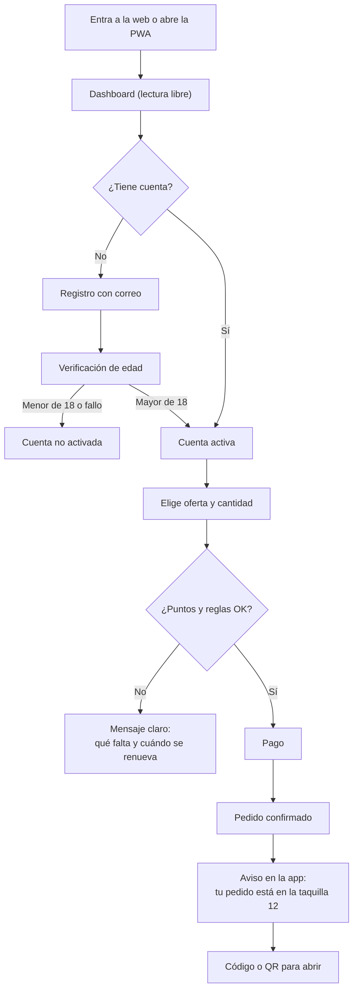

### 6.5 Tiempo real

El dashboard se actualiza solo mediante **SSE** (`GET /stream`): cuando alguien compra, baja el contador de "Quedan N"; cuando las reglas cambian, se actualiza el coste en puntos; cuando el pedido pasa a `IN_LOCKER`, aparece el aviso con el código. Si la conexión se cae, el cliente reintenta y recarga el estado.

### 6.6 PWA, accesibilidad e idiomas

- **PWA:** manifiesto, icono, pantalla completa, caché del *shell* de la app para que cargue rápido. Sin conexión se muestra el último listado y se **bloquea la compra** (nunca se encolan compras sin conexión: el stock es en vivo).
- **Web Push:** funciona sobre HTTPS (y en `localhost`); en iOS exige tener la PWA instalada **(verificar)**. En la demo, opcional.
- **Accesibilidad:** objetivo WCAG 2.1 AA; contraste, tamaños táctiles amplios, navegación por teclado, textos alternativos en las fotos; el estado nunca se comunica **solo** por color.
- **Idiomas:** castellano y valenciano; textos en ficheros de traducción, no incrustados.
- **Rendimiento:** primera pantalla útil en < 2,5 s en móvil de gama media (**supuesto**), imágenes optimizadas.

### 6.7 Publicar en menos de 30 segundos (productor)

Es el punto donde más riesgo hay de que los puestos no usen la herramienta. El formulario es **una sola pantalla de móvil**:

1. **Producto:** desplegable con sus plantillas habituales (o botón **"Repetir lo de ayer"**).
2. **Cantidad.**
3. **Precio** (campo libre; el precio habitual aparece como referencia y salta un aviso si lo supera).
4. **Perfil de restricciones:** Libre / Equilibrado / Estricto (por defecto, Equilibrado).
5. **Hasta cuándo** (por defecto, la hora de cierre del mercado).
6. **Publicar.**

La foto es opcional. Si publicar requiere más de 30 segundos, no se usará; en la demo se cronometra.

---

## 7. Identidad, mayoría de edad y una persona = una cuenta

Dos requisitos del proyecto dependen de lo mismo: *solo mayores de edad* y *puntos semanales que nadie pueda burlar*. Si una persona puede abrir cinco cuentas, los puntos no sirven. **Verificar la edad y fijar una persona por cuenta es la misma pieza técnica.** Un correo electrónico por sí solo no prueba ni la edad ni la unicidad.

### 7.1 Cuenta y sesión

- Alta con **correo + contraseña** o **enlace mágico** (más sencillo para personas poco técnicas). En la demo, el correo llega a Mailpit (un buzón local).
- Sesión por *cookie* `HttpOnly`, `SameSite=Lax` y protección CSRF. Sin *tokens* en `localStorage`.
- La cuenta nace en estado `PENDING` y **solo pasa a `ACTIVE` tras verificar la edad**. Mientras tanto se puede navegar, no reservar.

### 7.2 Opciones de verificación

| Opción | Fiabilidad | Fricción | Coste | Observaciones |
|---|---|---|---|---|
| **A. Cl@ve / certificado digital** | Alta | Media | Bajo | Encaja con un proyecto público. Requiere dar de alta el servicio con una administración (**¿participa el Ayuntamiento?**) |
| **B. Cartera de identidad digital europea / app europea de verificación de edad** | Alta | Baja | Bajo | Preserva privacidad (prueba "mayor de 18" sin revelar datos). **Verificar estado y disponibilidad actual** |
| **C. Proveedor privado de verificación (documento + selfie)** | Alta | Media | Por verificación | Rápido de integrar, pero se delega un dato sensible a un tercero |
| **D. Autodeclaración** | Muy baja | Mínima | Nulo | **No cumple el requisito.** Solo para pruebas |
| **Demo: `FakeAgeVerifier`** | (ninguna) | Mínima | Nulo | Pantalla que imita al proveedor; permite elegir "mayor" o "menor" para enseñar ambos caminos |

**Recomendación para producción:** A como vía principal si el Ayuntamiento colabora, con B como objetivo a medio plazo y C como contingencia durante el piloto.

### 7.3 Flujo (idéntico en demo y producción; cambia el proveedor)

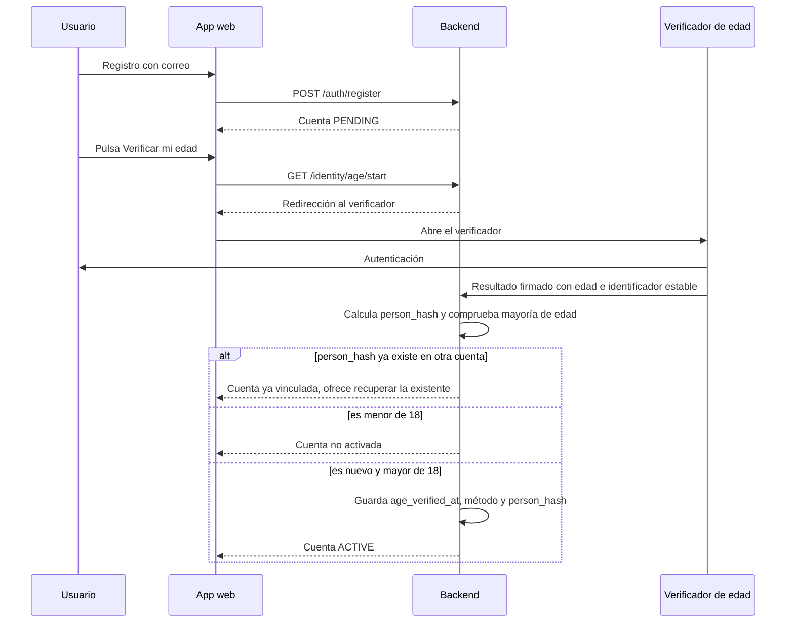

### 7.4 Qué se guarda

```
person_hash  = HMAC-SHA256(clave_secreta_del_servidor, identificador_estable_del_proveedor)
age_verified = true
age_verified_at, age_method ('clave'|'eudi'|'kyc'|'demo'), provider_ref
```

- No se almacena el documento, el nombre completo ni la fecha de nacimiento.
- `person_hash` tiene restricción `UNIQUE`: **dos cuentas no pueden compartir persona**.
- La clave secreta vive en un gestor de secretos, no en la base de datos.
- Recuperación: si alguien pierde el acceso a su correo, se reverifica y el `person_hash` pasa a la cuenta nueva (la antigua se desactiva), conservando saldo y reputación.
- **En la demo**, el "identificador estable" lo introduce quien presenta (un DNI inventado), lo que permite enseñar el bloqueo de duplicados: intentar crear una segunda cuenta con el mismo DNI falso la rechaza.

> Un fallo grave posible: si el proveedor devuelve identificadores distintos para la misma persona, la unicidad se rompe. Hay que comprobarlo al elegir proveedor.

---

## 8. Modelo de datos

### 8.1 Diagrama entidad-relación

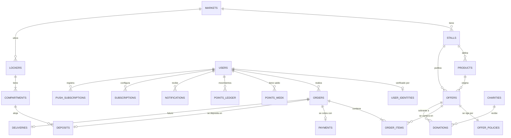

### 8.2 Esquema esencial (PostgreSQL)

```sql
-- ============ Mercados y puestos ============
CREATE TABLE markets (
  id            uuid PRIMARY KEY DEFAULT gen_random_uuid(),
  name          text NOT NULL,
  lat           double precision,
  lng           double precision,
  opens_at      time NOT NULL,
  closes_at     time NOT NULL,
  offers_from   time NOT NULL,              -- no se publica antes (evita canibalizar la venta normal)
  tz            text NOT NULL DEFAULT 'Europe/Madrid'
);

CREATE TABLE stalls (
  id            uuid PRIMARY KEY DEFAULT gen_random_uuid(),
  market_id     uuid NOT NULL REFERENCES markets,
  name          text NOT NULL,
  category      text NOT NULL,
  owner_user_id uuid,
  verified_at   timestamptz,                -- alta validada por la gestión del mercado
  payout_account_ref text                   -- referencia en el proveedor de pagos, nunca el IBAN
);

-- ============ Usuarios ============
CREATE TABLE users (
  id             uuid PRIMARY KEY DEFAULT gen_random_uuid(),
  email          citext UNIQUE NOT NULL,
  password_hash  text,                      -- NULL si solo usa enlace mágico
  display_name   text NOT NULL,
  role           text NOT NULL CHECK (role IN ('NEIGHBOR','PRODUCER','MANAGER','ADMIN')),
  lang           text NOT NULL DEFAULT 'es',
  reputation     numeric(3,2) NOT NULL DEFAULT 1.00,
  status         text NOT NULL DEFAULT 'PENDING'  -- PENDING hasta verificar edad
                 CHECK (status IN ('PENDING','ACTIVE','SUSPENDED','DELETED')),
  telegram_chat_id bigint,                  -- opcional y futuro: solo para avisos
  created_at     timestamptz NOT NULL DEFAULT now()
);

CREATE TABLE user_identities (
  user_id         uuid PRIMARY KEY REFERENCES users,
  person_hash     bytea UNIQUE NOT NULL,           -- una persona = una cuenta
  age_verified_at timestamptz NOT NULL,
  age_method      text NOT NULL,                   -- 'clave','eudi','kyc','demo'
  provider_ref    text
);

-- ============ Catálogo y ofertas ============
CREATE TABLE products (
  id             uuid PRIMARY KEY DEFAULT gen_random_uuid(),
  stall_id       uuid NOT NULL REFERENCES stalls,
  name           text NOT NULL,
  unit           text NOT NULL,                    -- 'kg','ud','bandeja'
  unit_weight_g  integer,                          -- para convertir a kg rescatados
  vat_rate       numeric(4,2) NOT NULL,            -- IVA según producto (verificar tipos)
  allergens      text[] NOT NULL DEFAULT '{}',
  food_class     text NOT NULL CHECK (food_class IN ('REFRIGERATED','AMBIENT')),
  usual_price_cents integer,
  photo_path     text
);

CREATE TABLE offers (
  id             uuid PRIMARY KEY DEFAULT gen_random_uuid(),
  stall_id       uuid NOT NULL REFERENCES stalls,
  product_id     uuid NOT NULL REFERENCES products,
  qty_total      integer NOT NULL CHECK (qty_total > 0),
  qty_available  integer NOT NULL CHECK (qty_available >= 0),
  price_cents    integer NOT NULL CHECK (price_cents >= 0),   -- lo fija el productor
  reference_price_cents integer,                              -- para mostrar el ahorro real
  pickup_from    timestamptz NOT NULL,
  pickup_until   timestamptz NOT NULL,
  status         text NOT NULL DEFAULT 'DRAFT'
                 CHECK (status IN ('DRAFT','ACTIVE','SOLD_OUT','EXPIRED','WITHDRAWN','DONATED','DISCARDED')),
  consume_by     text NOT NULL CHECK (consume_by IN ('TODAY','BEST_BEFORE')),
  created_at     timestamptz NOT NULL DEFAULT now(),
  CHECK (qty_available <= qty_total)
);

CREATE TABLE offer_policies (               -- reglas del productor para esa oferta (sección 10)
  offer_id    uuid PRIMARY KEY REFERENCES offers,
  profile     text NOT NULL,                -- 'LIBRE' | 'EQUILIBRADO' | 'ESTRICTO' | 'PERSONALIZADO'
  policy      jsonb NOT NULL,
  version     integer NOT NULL DEFAULT 1
);

-- ============ Puntos ============
CREATE TABLE points_week (                  -- saldo por usuario y semana
  user_id    uuid NOT NULL REFERENCES users,
  week_key   text NOT NULL,                 -- ej. '2026-W42' en hora de Madrid
  allowance  integer NOT NULL,
  spent      integer NOT NULL DEFAULT 0,
  PRIMARY KEY (user_id, week_key),
  CHECK (spent >= 0 AND spent <= allowance)
);

CREATE TABLE points_ledger (                -- libro inmutable: auditoría y reembolsos
  id         bigserial PRIMARY KEY,
  user_id    uuid NOT NULL REFERENCES users,
  week_key   text NOT NULL,
  delta      integer NOT NULL,              -- negativo = gasto, positivo = devolución
  reason     text NOT NULL,                 -- 'PURCHASE','REFUND_PRODUCER_FAULT','REFUND_CANCEL','ADMIN'
  order_id   uuid,
  created_at timestamptz NOT NULL DEFAULT now()
);

-- ============ Pedidos ============
CREATE TABLE orders (
  id               uuid PRIMARY KEY DEFAULT gen_random_uuid(),
  user_id          uuid NOT NULL REFERENCES users,
  stall_id         uuid NOT NULL REFERENCES stalls,
  status           text NOT NULL,           -- ver máquina de estados (sección 9)
  total_cents      integer NOT NULL,
  points_cost      integer NOT NULL,
  rules_applied    jsonb NOT NULL DEFAULT '[]',  -- explicabilidad: qué reglas pesaron
  idempotency_key  text UNIQUE NOT NULL,    -- evita duplicados por doble clic o reintento
  hold_expires_at  timestamptz,
  pickup_until     timestamptz NOT NULL,
  created_at       timestamptz NOT NULL DEFAULT now()
);

CREATE TABLE order_items (
  order_id    uuid NOT NULL REFERENCES orders,
  offer_id    uuid NOT NULL REFERENCES offers,
  qty         integer NOT NULL CHECK (qty > 0),
  unit_cents  integer NOT NULL,
  PRIMARY KEY (order_id, offer_id)
);

CREATE TABLE payments (
  id            uuid PRIMARY KEY DEFAULT gen_random_uuid(),
  order_id      uuid UNIQUE NOT NULL REFERENCES orders,
  provider      text NOT NULL,              -- 'fake','redsys','stripe',...
  provider_ref  text UNIQUE,
  amount_cents  integer NOT NULL,
  status        text NOT NULL,              -- 'PENDING','PAID','FAILED','REFUNDED'
  created_at    timestamptz NOT NULL DEFAULT now()
);

-- ============ Taquillas ============
CREATE TABLE lockers (
  id          uuid PRIMARY KEY DEFAULT gen_random_uuid(),
  market_id   uuid NOT NULL REFERENCES markets,
  device_id   text UNIQUE NOT NULL,         -- en la demo, un identificador virtual
  last_seen   timestamptz,
  firmware    text
);

CREATE TABLE compartments (
  id          uuid PRIMARY KEY DEFAULT gen_random_uuid(),
  locker_id   uuid NOT NULL REFERENCES lockers,
  slot        integer NOT NULL,
  size        text NOT NULL CHECK (size IN ('S','M','L')),
  zone        text NOT NULL CHECK (zone IN ('REFRIGERATED','AMBIENT')),
  status      text NOT NULL DEFAULT 'FREE'
              CHECK (status IN ('FREE','RESERVED','OCCUPIED','OUT_OF_SERVICE')),
  UNIQUE (locker_id, slot)
);

CREATE TABLE deposits (
  id              uuid PRIMARY KEY DEFAULT gen_random_uuid(),
  order_id        uuid UNIQUE NOT NULL REFERENCES orders,
  compartment_id  uuid NOT NULL REFERENCES compartments,
  code_hash       bytea NOT NULL,           -- el código de retirada nunca se guarda en claro
  valid_from      timestamptz NOT NULL,
  valid_until     timestamptz NOT NULL,
  deposited_at    timestamptz,
  picked_up_at    timestamptz
);

-- ============ Avisos y suscripciones ============
CREATE TABLE subscriptions (
  user_id     uuid NOT NULL REFERENCES users,
  market_id   uuid NOT NULL REFERENCES markets,
  categories  text[] NOT NULL DEFAULT '{}',
  quiet_from  time,
  quiet_to    time,
  PRIMARY KEY (user_id, market_id)
);

CREATE TABLE notifications (                -- bandeja dentro de la app
  id          bigserial PRIMARY KEY,
  user_id     uuid NOT NULL REFERENCES users,
  kind        text NOT NULL,                -- 'OFFER_MATCH','ORDER_READY','ORDER_CANCELLED',...
  payload     jsonb NOT NULL,
  read_at     timestamptz,
  created_at  timestamptz NOT NULL DEFAULT now()
);

CREATE TABLE push_subscriptions (           -- Web Push (opcional)
  id          bigserial PRIMARY KEY,
  user_id     uuid NOT NULL REFERENCES users,
  endpoint    text UNIQUE NOT NULL,
  keys        jsonb NOT NULL
);

-- ============ Eventos (auditoría y pipeline) ============
CREATE TABLE domain_events (                -- outbox
  id            bigserial PRIMARY KEY,
  occurred_at   timestamptz NOT NULL,       -- hora del Clock, no de la base de datos
  event_type    text NOT NULL,
  aggregate_id  uuid,
  payload       jsonb NOT NULL,
  published_at  timestamptz                 -- NULL hasta que el worker lo publica
);
```

> `occurred_at` se rellena con la hora del **reloj inyectable**, no con `now()` de la base de datos. Así los eventos de la demo (con reloj adelantado) quedan coherentes con las reglas y el pipeline.

### 8.3 Garantías de integridad que ya vienen en el esquema

- `CHECK (qty_available >= 0)` y `CHECK (spent <= allowance)`: aunque haya un fallo en el código, la base de datos **rechaza** el stock negativo y el gasto de puntos por encima del saldo.
- `UNIQUE (person_hash)`: no hay dos cuentas de la misma persona.
- `UNIQUE (idempotency_key)`: un doble clic o un reintento no genera dos pedidos.
- `UNIQUE (order_id)` en `deposits`: un pedido, una taquilla.

---

## 9. Ciclos de vida (máquinas de estado)

### 9.1 Oferta

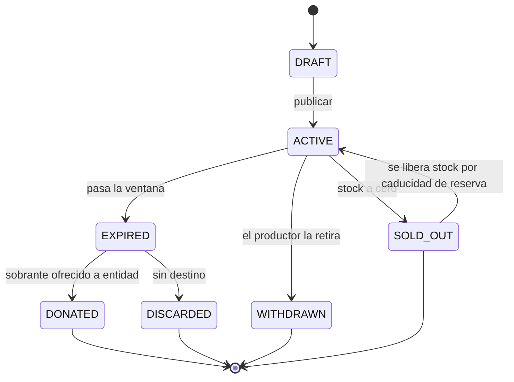

### 9.2 Pedido

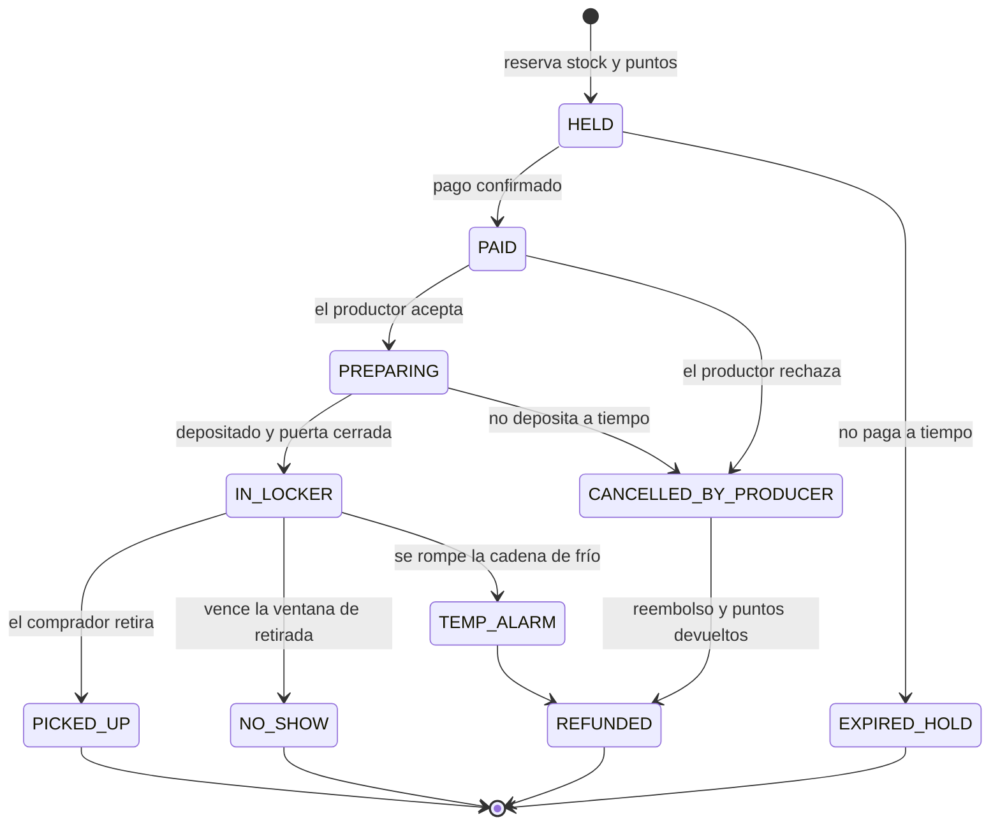

Reglas de cada transición relevante:

| Transición | Efecto |
|---|---|
| `HELD → EXPIRED_HOLD` (10 min sin pagar) | Se devuelve el stock y **se devuelven los puntos** |
| `PAID → CANCELLED_BY_PRODUCER` | Reembolso completo, puntos devueltos, **penalización al productor** |
| `IN_LOCKER → NO_SHOW` | Sin reembolso, **no se devuelven los puntos**, baja la reputación del comprador; el producto se ofrece a donación |
| `IN_LOCKER → TEMP_ALARM` | El producto se retira, reembolso y puntos devueltos, aviso al comprador y a la gestión |

### 9.3 Compartimento de taquilla

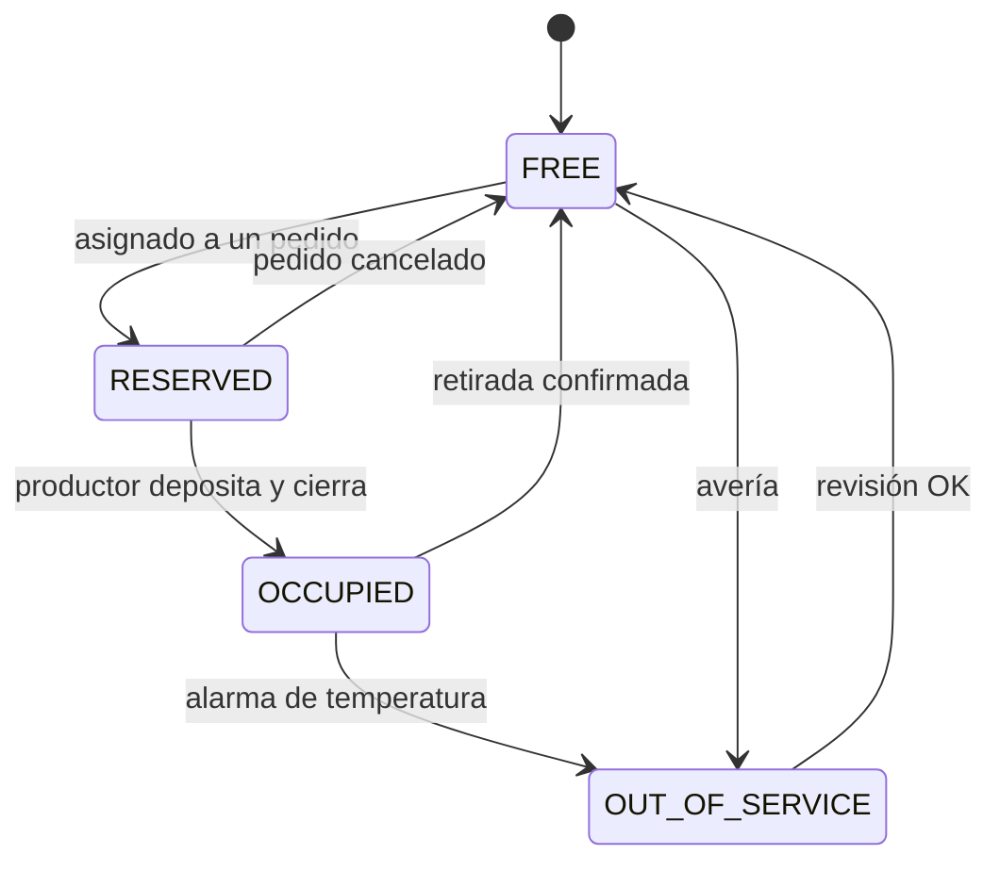

---

## 10. Precios, restricciones y sistema de puntos

Es la pieza que más distingue al proyecto. Hay **tres capas de control**, de menos a más prioritaria:

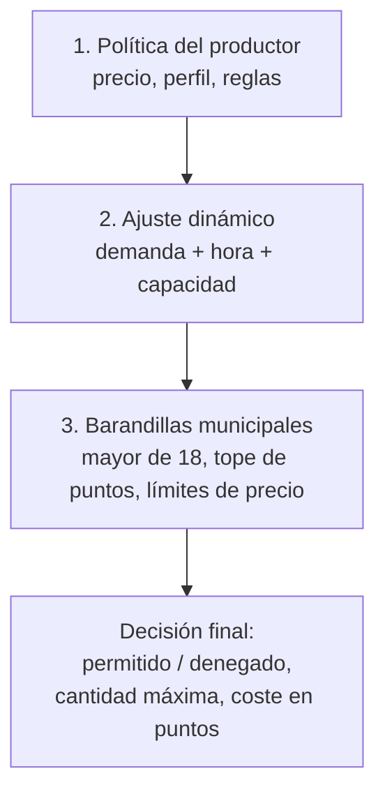

### 10.1 Precio libre con barandillas

El productor fija `price_cents` sin intervención. Aun así conviene tener **barandillas configurables** por el Ayuntamiento (decisión abierta):

| Barandilla | Efecto | Motivo |
|---|---|---|
| Precio de referencia visible | Se muestra el ahorro respecto a `reference_price_cents` | Transparencia hacia el comprador |
| Aviso si el precio supera el habitual | El productor ve una alerta, no un bloqueo | Detectar errores de teclado ("250" en vez de "2,50") |
| Tope máximo opcional (por ejemplo, ×1,0 del precio habitual) | Bloqueo duro | Evitar que la plataforma se use para vender más caro |
| Anuncio de rebaja | Si se anuncia un "descuento", el precio de referencia debe cumplir la norma de precio anterior (la directiva "Ómnibus" exige tomar el precio más bajo de los últimos 30 días) **(verificar con asesoría legal)** | Cumplimiento de consumo |

### 10.2 Perfiles de restricción

Para que publicar siga siendo rápido, el productor elige un **perfil** y solo entra en el modo personalizado si quiere.

| Perfil | Puntos por unidad | Máx. por persona | Comportamiento dinámico |
|---|---|---|---|
| **Libre** | Mínimo | Alto | Sube restricciones solo si el stock se agota muy rápido |
| **Equilibrado** (por defecto) | Medio | Medio | Sube el coste en puntos en horas pico y lo baja cerca del cierre |
| **Estricto** | Alto | Bajo | Reparte el producto entre más personas, aunque tarde más en venderse |
| **Personalizado** | Definido por el productor | Definido por el productor | Reglas propias (JSON) |

### 10.3 Señales que usa el motor

| Señal | Definición | Para qué sirve |
|---|---|---|
| `stock_ratio` | `qty_available / qty_total` | Cuánto queda |
| `demand_velocity` | Intentos de compra en los últimos 10 min ÷ stock disponible | Si se está agotando rápido |
| `minutes_to_close` | Minutos hasta `pickup_until` o cierre del mercado | Urgencia por vender antes de que se pierda |
| `time_band` | Franja horaria (apertura, media mañana, comida, cierre) | Patrones del día |
| `locker_free_slots` | Compartimentos libres compatibles en la ventana de recogida | **El stock vendible no puede superar la capacidad física** |
| `user_points_left` | Puntos que le quedan al usuario esta semana | Control del acceso |
| `user_reputation` | Fiabilidad (plantones previos) | Penalizar abuso |

> **Stock efectivo:** `min(qty_available, locker_free_slots)`. Con taquillas, el límite real de venta es el número de compartimentos disponibles, no solo el inventario del productor.
>
> Todas las señales temporales se calculan con el **reloj inyectable** (`Clock`), nunca con la hora del sistema. Es lo que permite adelantar el reloj en la demo y ver cambiar las reglas.

### 10.4 Formato de la política (JSON)

```json
{
  "version": 3,
  "base": {
    "points_per_unit": 2,
    "max_units_per_user": 3
  },
  "rules": [
    {
      "id": "pico-de-demanda",
      "when": { "demand_velocity_gte": 0.5 },
      "then": { "points_per_unit_mult": 2.0, "max_units_per_user": 2 }
    },
    {
      "id": "cierre-con-sobrante",
      "when": { "minutes_to_close_lte": 30, "stock_ratio_gte": 0.4 },
      "then": { "points_per_unit_mult": 0.5, "max_units_per_user": 6 }
    },
    {
      "id": "primera-hora-solo-fiables",
      "when": { "time_between": ["12:30", "13:00"] },
      "then": { "min_reputation": 0.6 }
    }
  ],
  "bounds": {
    "points_per_unit": [0, 6],
    "max_units_per_user": [1, 10]
  }
}
```

**Resolución de reglas:**

1. Se parte de `base`.
2. Se evalúan las reglas **en orden**; cada una cuyo `when` se cumple aplica su `then`. La última que toca un mismo campo gana.
3. Se aplican los `bounds` del productor (recorte).
4. Se aplican las **barandillas municipales** (recorte final; siempre ganan).
5. El resultado y las reglas aplicadas se guardan en el pedido (`orders.rules_applied`): se puede responder "¿por qué me costó 4 puntos?", y la app lo muestra (sección 6.3).

### 10.5 Evaluación (pseudocódigo)

```python
def evaluar(usuario, oferta, qty, clock) -> Decision:
    if usuario.status != "ACTIVE" or not usuario.edad_verificada:
        return Denegado("cuenta_no_verificada")

    senales = calcular_senales(oferta, clock.now())    # solo lectura
    politica = oferta.politica
    params = politica.base.copy()

    aplicadas = []
    for regla in politica.reglas:
        if cumple(regla.when, senales, usuario):
            params = aplicar(params, regla.then)
            aplicadas.append(regla.id)

    params = recortar(params, politica.bounds)         # límites del productor
    params = recortar(params, barandillas_municipales) # límites del Ayuntamiento

    if qty > params.max_units_per_user:
        return Denegado("supera_maximo", maximo=params.max_units_per_user)
    if usuario.reputacion < params.min_reputation:
        return Denegado("reputacion_insuficiente")

    coste_puntos = ceil(qty * params.points_per_unit)
    return Permitido(coste_puntos=coste_puntos, reglas=aplicadas)
```

La función es **pura** (mismos datos de entrada, misma decisión): se prueba con casos tabulados y se puede simular antes de lanzar. La misma función sirve para **mostrar** la decisión en el detalle de la oferta y para **aplicarla** al comprar.

### 10.6 Sistema de puntos semanales

**Objetivo:** que nadie acapare ni revenda; que el acceso al excedente se reparta entre más gente.

- Cada usuario verificado recibe `allowance` puntos por semana (**supuesto inicial: 20**; hay que calibrarlo con simulación y con el piloto).
- La semana es la ISO en hora de Madrid (`week_key = '2026-W42'`), calculada con el `Clock`. No hace falta un trabajo programado que "reinicie" saldos: el saldo de una semana nueva se crea al primer uso, y la semana anterior queda inmutable.
- Cada compra descuenta `points_cost` de forma **atómica con la reserva de stock**.
- Los puntos **no se acumulan** de una semana a otra (impide guardar saldo para acaparar).
- Devoluciones: sí en cancelación del productor, caducidad de la reserva sin pago y alarma de temperatura; no en plantón.

**Gasto atómico (una sola transacción):**

```sql
BEGIN;

-- 1) Crea el saldo de la semana si no existe
INSERT INTO points_week (user_id, week_key, allowance)
VALUES ($user, $week, $allowance)
ON CONFLICT DO NOTHING;

-- 2) Descuenta solo si queda saldo (si no afecta ninguna fila, se aborta)
UPDATE points_week
   SET spent = spent + $cost
 WHERE user_id = $user AND week_key = $week
   AND spent + $cost <= allowance
RETURNING allowance - spent AS left;

-- 3) Reserva stock solo si hay y la oferta sigue activa
UPDATE offers
   SET qty_available = qty_available - $qty
 WHERE id = $offer AND status = 'ACTIVE' AND qty_available >= $qty
RETURNING qty_available;

-- 4) Crea pedido + líneas + asiento en el libro, todo o nada
INSERT INTO orders (...) VALUES (...);
INSERT INTO points_ledger (user_id, week_key, delta, reason, order_id)
VALUES ($user, $week, -$cost, 'PURCHASE', $order);

COMMIT;
```

Si cualquiera de las dos actualizaciones condicionales no afecta ninguna fila, se hace `ROLLBACK` y se devuelve el motivo exacto. Sin bloqueos explícitos: la condición dentro del `UPDATE` ya es atómica.

### 10.7 Otras defensas contra el abuso (además de los puntos)

| Amenaza | Defensa |
|---|---|
| Varias cuentas por persona | `person_hash` único (sección 7) |
| Acaparar para revenderlo | Máximo por persona y por oferta; puntos; detección de patrones |
| Plantones | Reputación; pérdida de puntos; limitación progresiva de reservas |
| Bots que compran a gran velocidad | Límite de peticiones por usuario e IP; prueba humana si hay anomalías |
| Productor que infla precios | Barandillas, avisos y revisión de la gestión |
| Productor que cancela mucho | Indicador de fiabilidad visible para la gestión y penalización |
| Fraude de pago | Delegado a la pasarela (3-D Secure) |

### 10.8 Cuestiones de equidad (a decidir)

- ¿Mismos puntos para un hogar de una persona que para uno de cinco? (la cuenta es personal, pero la compra de comida suele ser familiar).
- ¿Hay un saldo extra para personas con acceso social a ayudas?
- Un sistema pensado para evitar abuso puede acabar excluyendo a quien más lo necesita si el reparto de puntos es demasiado estricto. Conviene medirlo en el piloto y en la simulación.

---

## 11. Flujo de compra de extremo a extremo

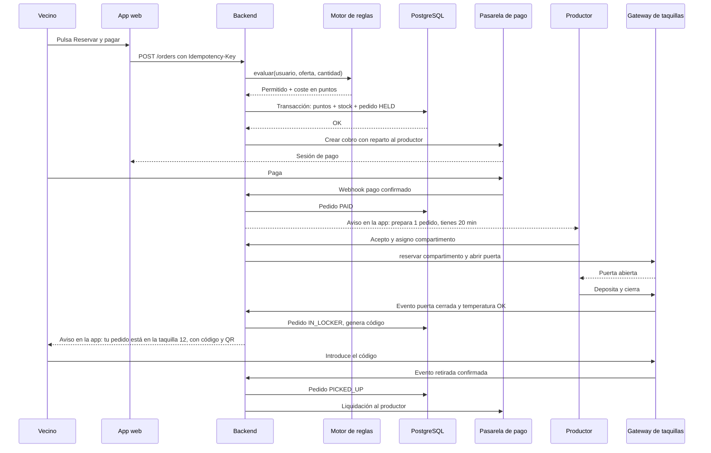

En la demo, `PAY` es el pago simulado y `L` es el simulador de taquillas; **el resto del recorrido es el código real**.

### 11.1 Robustez

| Situación | Tratamiento |
|---|---|
| El usuario pulsa dos veces o el navegador reintenta | `Idempotency-Key` único; la segunda llamada devuelve el pedido ya creado |
| El usuario no paga | Caducidad de la reserva a los 10 min: devuelve stock y puntos |
| El webhook de pago llega tarde o duplicado | Se procesa de forma idempotente por `payment_id`; si llega con el pedido ya caducado, se reembolsa automáticamente |
| El productor no acepta o no deposita | Plazo de preparación (**supuesto**: 20 min); si vence, cancelación, reembolso y penalización |
| Taquilla sin conexión al depositar | Funciona offline (sección 13.4); los eventos se sincronizan al volver |
| El usuario no retira | Al vencer la ventana: `NO_SHOW`, el producto se retira y se ofrece a donación |
| Cierre del mercado con ofertas activas | El worker de caducidades pasa las ofertas a `EXPIRED` y lanza el flujo de donación |
| Dos personas compran la última unidad | La actualización condicional del stock solo deja pasar a una; la otra recibe "agotada" |

---

## 12. Pagos

### 12.1 Quién tiene el dinero

Si la plataforma recibe el dinero de los compradores y se lo reparte a los productores, puede entrar en el ámbito de las **entidades de pago reguladas** (PSD2) **(verificar con asesoría legal)**. La forma segura de evitarlo es usar un proveedor de pagos **con soporte nativo de marketplace** (reparto automático al vendedor, KYC del productor a cargo del proveedor). El dinero nunca pasa por una cuenta del proyecto.

### 12.2 Interfaz de proveedor

```
interface PaymentProvider:
    crear_cobro(pedido, comprador, destino_productor, comisión) -> sesión_de_pago
    reembolsar(pago_id, importe) -> resultado
    consultar(pago_id) -> estado
    verificar_webhook(petición) -> evento_validado
    crear_cuenta_vendedor(productor) -> referencia

class FakePaymentProvider(PaymentProvider):   # demo
    # pantalla propia con botones "Pagar" / "Fallar" / "Tarda"
    # emite el webhook al backend como lo haría un proveedor real

class RedsysProvider(PaymentProvider): ...    # producción (u otro)
```

La pantalla de pago simulado permite **provocar** un fallo o un retraso a propósito para enseñar que el stock y los puntos se devuelven.

### 12.3 Opciones para producción

| Opción | Pros | Contras |
|---|---|---|
| **Pasarela con Bizum y tarjeta** (Redsys u otra) | Muy extendida en España; Bizum | Integración propia del reparto a vendedores |
| **Proveedor de marketplace** (Stripe Connect u otro) | Reparto y KYC de vendedores incluidos | Coste y dependencia de un tercero |

### 12.4 Otros aspectos

- **IVA:** cada producto lleva su tipo (`vat_rate`); el justificante debe indicarlo. Facturación al comprador: **decisión abierta**.
- **Comisión:** el proyecto es público; por defecto 0 %. Si hay comisión, se calcula como `fee_cents` en el reparto.
- **Desistimiento:** los bienes perecederos están exceptuados del derecho de desistimiento **(verificar)**; se informa claramente antes de pagar.
- **Reembolsos:** automáticos en cancelación del productor, alarma de temperatura o fallo del sistema. No hay reembolso por plantón.

---

## 13. Taquillas refrigeradas

### 13.1 Arquitectura

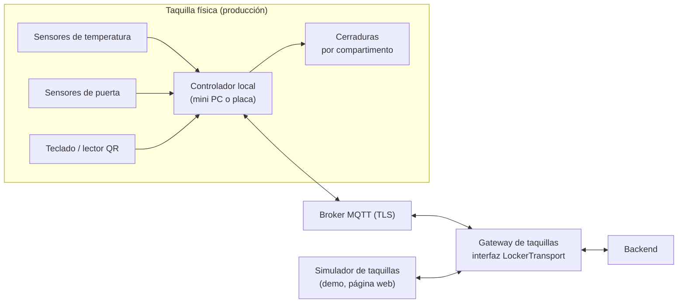

- El **controlador local** decide por sí mismo si abrir o no, aunque no haya red.
- El **gateway** traduce entre el dispositivo y el dominio (`abrir`, `puerta_cerrada`, `temperatura`) a través de la interfaz `LockerTransport`, con dos implementaciones: `MqttTransport` (producción) e `InProcessSimulator` (demo).
- Hardware: opción de comprar taquillas comerciales con API o montar un controlador propio con sensores y relés. **Decisión abierta** (coste, mantenimiento, homologación eléctrica y sanitaria).

### 13.2 Protocolo (temas MQTT, producción)

| Tema | Dirección | Contenido |
|---|---|---|
| `lockers/{id}/cmd/open` | servidor → taquilla | Orden de apertura del compartimento (para depósito) |
| `lockers/{id}/cmd/codes` | servidor → taquilla | Lote de códigos vigentes (solo hashes) con ventanas de validez |
| `lockers/{id}/evt/door` | taquilla → servidor | Puerta abierta/cerrada, compartimento, marca de tiempo |
| `lockers/{id}/evt/pickup` | taquilla → servidor | Retirada con éxito (código usado) |
| `lockers/{id}/evt/temp` | taquilla → servidor | Lectura de temperatura cada 60 s |
| `lockers/{id}/evt/alarm` | taquilla → servidor | Temperatura fuera de rango, puerta mal cerrada, manipulación |
| `lockers/{id}/evt/heartbeat` | taquilla → servidor | Estado de salud |

**Seguridad:** cada dispositivo tiene su propio certificado (TLS mutuo) y solo puede publicar y suscribirse a sus propios temas.

### 13.3 Flujo de depósito y retirada

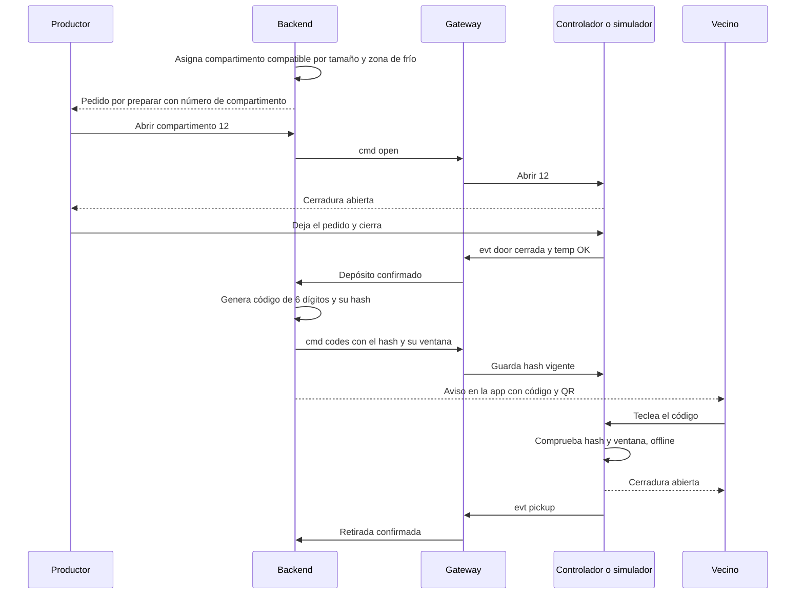

### 13.4 Funcionamiento sin conexión

El controlador guarda **solo hashes** de los códigos vigentes y sus ventanas de validez. Al introducir un código, comprueba el hash y la ventana en local y abre. Los eventos se acumulan en una cola local y se sincronizan al recuperar la red. Un código usado queda marcado en el controlador para que no se pueda repetir mientras dure la desconexión.

> **Límite conocido:** si la red cae **antes** de enviarse un código nuevo, ese pedido no podrá abrirse hasta que vuelva la conexión. El tiempo de espera hasta marcar una taquilla "fuera de servicio" y el protocolo de soporte presencial se definen en el piloto.

### 13.5 Cadena de frío y seguridad alimentaria

- Rango de la zona refrigerada: **0–4 °C** objetivo; alarma si se superan **5 °C durante más de 15 minutos** (**supuesto**, hay que validarlo con la normativa de higiene y el plan APPCC del Ayuntamiento) **(verificar)**.
- Las lecturas se guardan como registro (retención mínima, plazo por **verificar**).
- Si hay alarma, los pedidos de ese compartimento pasan a `TEMP_ALARM` automáticamente, con reembolso, y la gestión recibe aviso.
- Categorías que **no** pueden usar taquilla ambiente: carne, pescado, lácteos, elaborados.
- Etiquetado por pedido: producto, alérgenos y "consumir hoy" / "consumo preferente".

### 13.6 Capacidad y asignación

| Variable | Gestión |
|---|---|
| Tamaños `S/M/L` | El producto declara su tamaño; se asigna el compartimento más pequeño que sirva |
| Zonas `REFRIGERATED/AMBIENT` | Según `food_class` del producto |
| Falta de huecos | `locker_free_slots` limita el stock vendible (sección 10.3) |
| Compartimento averiado | `OUT_OF_SERVICE` sale del cómputo y de la asignación |
| Ventana de retirada | Si caduca, se libera el compartimento y se sigue el flujo de no retirado |

**Variante a evaluar:** además de "preparar a pedido", se puede permitir **lotes preporcionados** (el productor deja bolsas ya hechas antes de vender). Reduce el tiempo de preparación, pero ocupa compartimentos sin garantía de venta. Se valora en el piloto.

### 13.7 El simulador de taquillas (demo)

Una página (`/sim/taquillas`) que dibuja una taquilla virtual: una cuadrícula de puertas con su estado (libre, reservada, ocupada, fuera de servicio), un **termómetro por compartimento** y estos controles:

| Control | Efecto |
|---|---|
| Teclado numérico | Hace de teclado de la taquilla para retirar con el código |
| Botón "Cerrar puerta" | Simula que el productor cierra tras depositar |
| Deslizador de temperatura | Sube la temperatura de un compartimento para **provocar una alarma** |
| Botón "Cortar red" | La taquilla pasa a modo offline: sigue abriendo con los códigos que ya tenía |
| Botón "Avería" | Marca un compartimento `OUT_OF_SERVICE` |

Habla con el backend mediante la misma interfaz `LockerTransport` y emite los mismos eventos que el hardware real, de forma que **el dominio no sabe que es un simulador**.

---

## 14. Notificaciones

### 14.1 Canales

| Canal | Demo | Producción | Notas |
|---|---|---|---|
| **En la app** (bandeja + SSE) | Sí | Sí | Canal principal; sin cuota externa |
| **Web Push** (PWA) | Opcional | Sí | Requiere permiso del usuario; en iOS exige PWA instalada **(verificar)** |
| **Correo** | Capturado en Mailpit | Sí | Para eventos importantes (pedido listo, reembolso) |
| **Telegram** | No | Opcional | **Solo avisos**, no compras (sección 14.4) |

### 14.2 Diseño

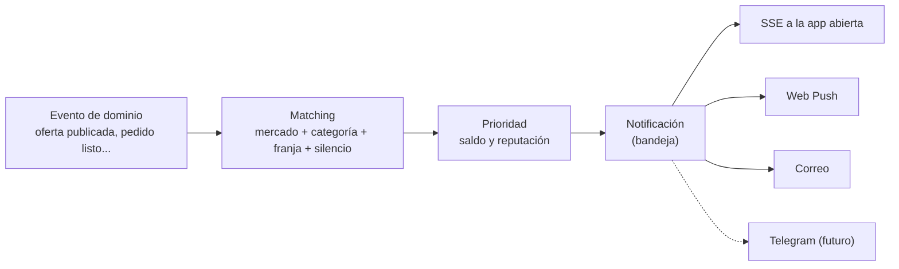

**Reglas de matching:**

- Se notifica a quien tiene suscripción al mercado y a la categoría, dentro de su franja horaria y fuera de su modo silencio.
- **Tope diario** de avisos por usuario (por defecto, 5), para no saturar.
- **Agrupación:** varias ofertas en una ventana de 5 minutos se unen en un único aviso.
- **Prioridad:** primero quienes tengan puntos suficientes y buena reputación (no sirve avisar a quien no puede comprar).
- **Personalización:** quien compró en un puesto o categoría recibe antes los avisos afines.

**Contenido del aviso:** producto, precio, cantidad restante, hasta cuándo, **coste en puntos para ti** y un enlace directo a `/oferta/:id`.

### 14.3 Interfaz `Notifier`

```
interface Notifier:
    enviar(usuario, notificacion) -> resultado

class InAppNotifier(Notifier): ...        # guarda en `notifications` y empuja por SSE
class WebPushNotifier(Notifier): ...      # producción u opcional
class EmailNotifier(Notifier): ...        # SMTP (Mailpit en demo)
class TelegramNotifier(Notifier): ...     # futuro
```

El dominio emite "intenciones de notificación" (`oferta_publicada`, `pedido_listo`, ...) y el módulo de notificaciones decide por qué canales entregarlas según las preferencias del usuario.

### 14.4 Telegram (opcional y futuro, solo avisos)

Si sobra tiempo en el hackathon, o ya en producción, Telegram se añade **sin tocar el dominio**: es un `Notifier` más. Alcance deliberadamente pequeño:

| Opción | Esfuerzo | Qué hace | Limitación |
|---|---|---|---|
| **Canal público por mercado** (ej. "Ofertas Ruzafa") | Muy bajo (una llamada a `sendMessage` al publicar una oferta) | Difusión a todos los suscriptores del canal, con enlace a la web | Sin personalización; no hay saldo de puntos por persona |
| **Bot de avisos personales** | Bajo-medio | El usuario enlaza su cuenta (`/start <token>` desde un botón de la web), guarda su `telegram_chat_id` y recibe avisos suyos | Hay que gestionar bajas y bloqueos |

- **No se compra por Telegram**: el mensaje solo lleva un enlace a la web.
- **Límites de la plataforma:** del orden de 30 mensajes/s en total y ~1 mensaje/s por chat **(verificar cifras actuales)**. Con una difusión masiva a miles de personas, hace falta una cola con límite de tasa; el canal público evita este problema.
- Un bot no puede escribir a quien no lo haya iniciado ni a quien lo haya bloqueado (error 403): se marca el canal como inactivo.
- **Plan de mínimos para el hackathon:** publicar en un canal desde el backend con un *token* de bot y un identificador de canal, en una función de ~15 líneas.

---

## 15. Envíos a domicilio (futuro)

Se diseña hoy la **interfaz**, no la integración, para que el futuro no obligue a reescribir pedidos ni taquillas.

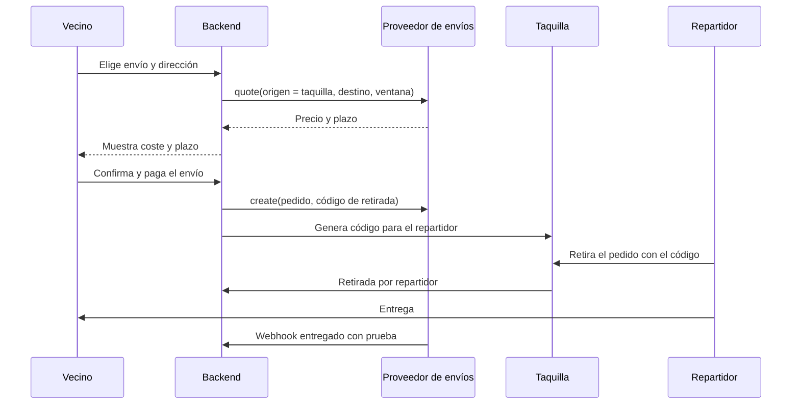

```
interface DeliveryProvider:
    cotizar(origen, destino, ventana, tipo_de_frío) -> oferta
    crear(pedido, origen, destino) -> envío_id
    cancelar(envío_id)
    estado(envío_id) -> estado
    verificar_webhook(petición) -> evento_validado
```

**Condiciones de diseño:**

- Origen del envío = **taquilla**; el repartidor se identifica con un código propio de un solo uso (mismo mecanismo de códigos).
- **Cadena de frío:** bolsa térmica y tiempo máximo de trayecto (por ejemplo, 45 minutos). Algunas categorías pueden excluirse de envío.
- **Mayoría de edad:** la entrega es al titular verificado.
- **Dirección:** dato personal; cifrada y eliminada tras la entrega (retención mínima).
- **Pagos:** el envío se paga en el mismo checkout y se liquida al proveedor.
- **Responsabilidad:** contrato con el privado que cubra daños, retrasos y seguro; se define con asesoría.

---

## 16. Pipeline de datos

Objetivos: **(1)** medir el impacto real (kg rescatados, CO₂, dinero), **(2)** operar mejor (demanda, precios sugeridos, capacidad de taquillas), **(3)** publicar datos abiertos útiles para el Ayuntamiento **sin exponer a nadie**.

### 16.1 Vista general

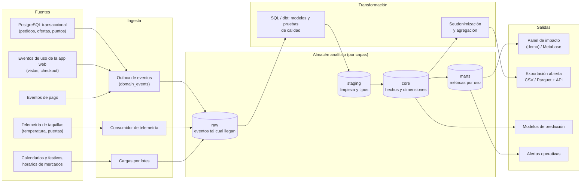

### 16.2 Ingesta: patrón *outbox*

1. En la misma transacción que cambia un pedido, se inserta una fila en `domain_events`. Si la transacción falla, ni cambio ni evento; si va bien, **los dos**.
2. Un worker lee las filas con `published_at IS NULL`, las publica en el *stream* (Redis en producción; directamente a `raw.events` en la demo) y marca `published_at`.
3. El consumidor analítico escribe en `raw.events` de forma **idempotente** (clave: `event_id`). Reprocesar nunca duplica.

Esto evita el clásico fallo de "el pedido se guardó pero el evento se perdió" y deja una **línea de tiempo auditable** de todo lo que ha pasado.

### 16.3 Catálogo de eventos

| Evento | Quién lo emite | Datos clave (sin datos personales directos) |
|---|---|---|
| `offer.published` | Catálogo | offer_id, stall_id, product_id, qty, price_cents, pickup_window |
| `offer.price_changed` | Catálogo | offer_id, antiguo, nuevo |
| `offer.expired` / `offer.withdrawn` | Catálogo | offer_id, qty_remaining |
| `app.offer_viewed` | App web | user_pseudo_id (o anónimo), offer_id |
| `app.checkout_started` | App web | user_pseudo_id, offer_id |
| `notification.sent` | Notificaciones | canal, audiencia, offer_id, latency_ms |
| `order.held` | Pedidos | order_id, user_pseudo_id, offer_id, qty, points_cost, reglas aplicadas |
| `order.denied` | Motor de reglas | user_pseudo_id, offer_id, motivo (`sin_puntos`, `supera_maximo`, ...) |
| `order.paid` | Pagos | order_id, importe |
| `order.deposited` | Taquillas | order_id, compartment_id, tiempo desde pago |
| `order.picked_up` | Taquillas | order_id, tiempo hasta retirada |
| `order.no_show` / `order.cancelled` | Pedidos | order_id, causa |
| `points.spent` / `points.refunded` | Puntos | user_pseudo_id, week_key, delta |
| `locker.temp_reading` | Gateway | locker_id, compartment_id, celsius |
| `locker.alarm` | Gateway | locker_id, tipo |
| `donation.completed` | Donaciones | offer_id, charity_id, qty |
| `user.verified` | Identidad | user_pseudo_id, método (sin datos de identidad) |

`user_pseudo_id` es un identificador derivado que **no** es el `id` de la cuenta ni el `person_hash`; solo permite contar usuarios únicos y seguir un comportamiento sin saber quién es. La analítica de uso (`app.*`) es **propia**, sin rastreadores de terceros.

### 16.4 Capas del almacén

| Capa | Contenido | Reglas |
|---|---|---|
| `raw` | Eventos tal cual llegan | Inmutable, retención limitada |
| `staging` | Tipos corregidos, duplicados eliminados, zonas horarias normalizadas | Una tabla (o vista) por tipo de evento |
| `core` | **Hechos** (`fct_orders`, `fct_offers`, `fct_locker_readings`) y **dimensiones** (`dim_stall`, `dim_market`, `dim_product`, `dim_date`) | Modelo en estrella |
| `marts` | Tablas pensadas para cada uso (impacto, operaciones, predicción) | Una por consumidor |

### 16.5 Métricas (definiciones exactas)

| Métrica | Definición | Nota |
|---|---|---|
| **Kg rescatados** | Σ (`qty` de pedidos `PICKED_UP` × `unit_weight_g`) / 1000 | Requiere `unit_weight_g` en el catálogo |
| **Kg donados** | Igual, para `donation.completed` | |
| **Tasa de venta (sell-through)** | unidades retiradas ÷ unidades publicadas | La métrica central de éxito |
| **Tasa de agotamiento** | % de ofertas que llegan a `SOLD_OUT` | Si es muy alta, el producto está infravalorado |
| **Tiempo hasta agotar** | minutos de `offer.published` a `SOLD_OUT` | Base para ajustar las reglas |
| **Conversión** | pedidos pagados ÷ `app.offer_viewed` únicos | Detecta fricción en el embudo |
| **Tasa de plantones** | `NO_SHOW` ÷ pedidos pagados | |
| **Denegaciones por puntos** | `order.denied` con motivo `sin_puntos` ÷ intentos | Indica si el saldo semanal es demasiado bajo |
| **Concentración de compras** | % de unidades vendidas al 10 % de usuarios que más compran | Detecta acaparamiento |
| **Utilización de taquillas** | compartimento-horas ocupados ÷ disponibles | |
| **Incidencias de frío** | alarmas por 1 000 horas-compartimento | |
| **Ingresos para productores** | Σ importes pagados − comisión | |
| **CO₂ evitado (estimado)** | Σ kg rescatados × factor de emisión por categoría | El factor y su fuente deben citarse (**por definir**) |

### 16.6 Calidad de datos

Pruebas automáticas en cada ejecución:

- **Unicidad y no nulos:** `order_id`, `event_id`.
- **Integridad referencial:** todo pedido tiene oferta, puesto y usuario.
- **Reglas de negocio:** `qty_available ≥ 0`; `spent ≤ allowance`; `deposited_at ≥ paid_at`; ningún `picked_up` sin `deposited`.
- **Frescura:** si el último evento tiene más de N minutos en horario de mercado, alerta.
- **Reconciliación:** pagos del proveedor = pagos en la base de datos (diaria; en la demo, contra el pago simulado).
- **Volumen:** caída o pico anómalo respecto a la semana anterior.

### 16.7 Orquestación y cadencia

| Flujo | Cadencia | Salida |
|---|---|---|
| Ingesta de eventos | Continua (segundos) | `raw` |
| Ingesta de telemetría | Continua | `raw`, serie temporal |
| Modelos `staging` → `marts` | Cada 15 min en horario de mercado (en la demo: al avanzar el reloj o cada minuto); completo cada noche | `core`, `marts` |
| Cierre diario | 16:00 (hora del `Clock`) | Resumen del día, donaciones pendientes |
| Pruebas de calidad | Tras cada ejecución | Alertas |
| Exportación abierta | Semanal (en la demo, bajo demanda) | CSV / Parquet |
| Entrenamiento de modelos | Semanal (cuando existan) | Modelo versionado |

### 16.8 El pipeline en la demo

No hace falta montar toda la infraestructura de producción para enseñar el flujo de datos. En la demo:

| Etapa | Implementación en la demo |
|---|---|
| Outbox | La tabla `domain_events` real |
| `raw` / `staging` | Esquemas `raw` y `staging` en el **mismo PostgreSQL**; `staging` como vistas |
| `core` / `marts` | Vistas materializadas, refrescadas por el planificador interno (o al mover el reloj) |
| Calidad | Un script de pruebas SQL que se ejecuta tras cada refresco y se muestra en `/admin/calidad` |
| Salida | **Panel de impacto** en `/admin` (kg rescatados, tasa de venta, mapa de calor por franja, taquillas) y `GET /open-data/*.csv` |
| Datos históricos | El *seed* genera **4 semanas de actividad** con un patrón realista (más demanda los viernes y a mediodía) para que el panel no salga vacío |

Dbt y Metabase quedan como extra opcional (perfil de Compose `analytics`); si no hay tiempo, el panel propio cumple.

### 16.9 Privacidad en el análisis

- El almacén **no contiene** correo, nombre ni `person_hash`. Solo `user_pseudo_id`.
- Las publicaciones abiertas solo muestran **agregados** (por mercado, día, categoría). Se aplica un **umbral mínimo** (por ejemplo, no publicar una celda con menos de 5 pedidos; **parámetro configurable**) para evitar identificar casos individuales.
- Los datos de bajo nivel (`raw`) se conservan durante un tiempo limitado (por definir con el delegado de protección de datos); los agregados, sin límite.
- Acceso por rol: la gestión ve agregados; el equipo técnico, `core` con pseudónimos; solo un administrador excepcional puede reidentificar, con registro de acceso.

### 16.10 Modelos de predicción (fase posterior, con evidencia previa)

| Modelo | Pregunta | Entradas | Uso |
|---|---|---|---|
| **Probabilidad de agotarse** | ¿Se venderá esta oferta antes del cierre? | Producto, precio relativo, hora, día de la semana, meteorología, histórico del puesto | Aviso al productor: "a este precio probablemente sobre" |
| **Sugerencia de precio** | ¿Qué precio maximiza la venta sin regalar? | Mismas + elasticidad estimada | **Sugiere, no decide** (el precio es del productor) |
| **Demanda por franja** | ¿Cuántas compras habrá entre 13:00 y 14:00? | Histórico por mercado y producto | Ajustar reglas y capacidad de taquillas |
| **Detección de abuso** | ¿Este patrón de compra es anómalo? | Frecuencia, concentración, horarios | Cola de revisión manual |

Primero, una línea base simple (medias por franja y producto); solo si aporta, modelos de gradiente. Se evalúa con **validación temporal** (entrenar con el pasado, probar con el futuro), nunca con mezcla aleatoria. Hacen falta **varias semanas de datos reales** antes de confiar en ellos: los datos inventados de la demo **no sirven** para entrenar nada que se presente como real.

---

## 17. Demo reproducible en localhost

### 17.1 Objetivo y criterios de aceptación

Que cualquier persona del equipo (o del jurado) pueda clonar el repositorio, ejecutar **un comando** y ver el recorrido completo, **sin internet, sin cuentas ni claves**, con el mismo resultado cada vez.

| Criterio | Cómo se comprueba |
|---|---|
| Arranque con un solo comando | `make demo` deja todo funcionando |
| Sin dependencias externas | Se prueba con la red desconectada |
| Determinista | Mismo *seed* ⇒ mismos datos; `make reset` vuelve al estado inicial |
| Rápido | Arranque en frío < 3 min (**supuesto**) |
| Verificable | `make e2e` recorre el guion principal con un navegador automatizado y falla si algo se rompe |

### 17.2 Servicios (Docker Compose)

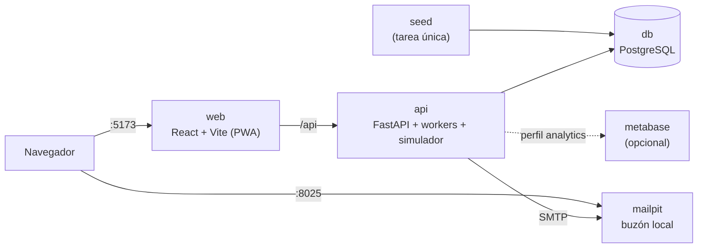

| Servicio | Puerto (propuesto) | Función |
|---|---|---|
| `web` | 5173 | La app (dashboard, productor, gestión, demo) |
| `api` | 8000 | Backend, SSE, workers internos, simulador de taquillas, pago simulado |
| `db` | 5432 | PostgreSQL |
| `mailpit` | 8025 | Bandeja de correo local (enlaces mágicos, avisos) |
| `seed` | (una vez) | Carga los datos inventados |
| `metabase` | 3000 | Opcional, con `--profile analytics` |

### 17.3 Comandos

```
make demo      # levanta todo, migra y carga los datos
make reset     # borra y recarga los datos (mismo seed)
make seed SEED=42   # otro conjunto de datos, reproducible
make e2e       # recorre el guion principal con Playwright
make test      # pruebas unitarias y de concurrencia
make down      # apaga y limpia
```

Configuración en `.env.example` (se copia a `.env` sin tocar nada):

```
DEMO_MODE=true
ALLOWED_HOSTS=localhost,127.0.0.1     # la app no arranca en demo fuera de localhost
DEMO_SEED=42
DEMO_CLOCK_START=2026-10-16T11:30:00  # el reloj de demo arranca antes de la hora punta
AGE_VERIFIER=fake
PAYMENT_PROVIDER=fake
LOCKER_TRANSPORT=sim
NOTIFIERS=inapp,email                  # añadir 'telegram' si se llega
SMTP_HOST=mailpit
```

### 17.4 Datos inventados (seed determinista)

Generados con un generador pseudoaleatorio con semilla fija, para que sean idénticos en cualquier máquina. **Los nombres de mercados son reales; los puestos, productos, personas y ventas son ficticios** y así debe constar en la pantalla de inicio de la demo.

| Entidad | Cantidad | Detalle |
|---|---|---|
| Mercados | 3 | Ruzafa, Colón y un tercero, con horarios y coordenadas |
| Puestos | ~12 | Frutería, pescadería, carnicería, panadería... con nombres inventados |
| Productos | ~40 | Con unidad, peso unitario, alérgenos y clase de frío |
| Ofertas de "hoy" | ~25 | En estados variados: activas, casi agotadas, a punto de cerrar |
| Taquillas | 4 (12 compartimentos cada una) | Tamaños y zonas mezclados |
| Entidades sociales | 2 | Para el flujo de donación |
| Historial | 4 semanas | Pedidos, plantones, donaciones y lecturas de temperatura |

**Usuarios de demo** (contraseña común, mostrada en pantalla):

| Usuario | Para qué sirve |
|---|---|
| `marta@demo.test` | Vecina verificada con todos los puntos |
| `luis@demo.test` | Verificado con **0 puntos** restantes (enseña el bloqueo) |
| `ana@demo.test` | Verificada con baja reputación (enseña la restricción) |
| `nuevo@demo.test` | Cuenta sin verificar (recorrido de alta) |
| `pepa@demo.test` | Productora (frutería) |
| `gestion@demo.test` | Gestión del Ayuntamiento |

### 17.5 Reloj de demo y simulador de demanda

Panel `/demo`:

| Control | Para qué |
|---|---|
| **Reloj:** saltos a 11:30 · 12:30 · 13:00 · 13:45 · 15:00 (y "+10 min") | Enseñar cómo cambian las reglas con la hora y cómo cierra el mercado |
| **Simulador de demanda:** baja / media / alta | Genera **compradores sintéticos que usan la API real**, así que las reglas reaccionan de verdad |
| **Reiniciar datos** | Vuelve al estado inicial en segundos |
| **Provocar incidencias** | Fallo de pago, alarma de frío, productor que no deposita |

Requisito de diseño: **ninguna lógica de negocio lee la hora del sistema**; todo pasa por `Clock`. Si alguien llama a `now()` directamente, el reloj de demo deja de funcionar y las reglas dinámicas no se pueden enseñar. Una prueba automática rastrea el código en busca de llamadas directas a la hora del sistema.

### 17.6 Guion de demostración (≈ 6 minutos)

| # | Escena | Qué se enseña | Requisito que demuestra |
|---|---|---|---|
| 1 | Dashboard como Marta | Layout de tarjetas, precios, "quedan N", coste en puntos | RF-06 |
| 2 | Registro de `nuevo@` con un DNI de menor | Bloqueo por edad | RF-05 |
| 3 | Segundo registro con el mismo DNI falso | Bloqueo de cuenta duplicada | RF-05, puntos |
| 4 | Marta compra tomates | Puntos que bajan, stock que baja en vivo | RF-04, RNF-01 |
| 5 | Luis intenta comprar | "Te faltan puntos. Se renuevan el lunes." | RF-04 |
| 6 | Pepa recibe el pedido, lo prepara y lo "deposita" | Flujo del productor | RF-07 |
| 7 | Taquilla virtual: Marta teclea el código | Retirada y cierre del pedido | RF-07 |
| 8 | **Demanda alta** en el simulador | El coste en puntos sube y el máximo por persona baja | RF-03 |
| 9 | **Reloj a las 13:45** | El coste baja, se relajan los límites, el mercado cierra, el sobrante pasa a **donación** | RF-03, RF-09 |
| 10 | Alarma de temperatura | Pedido en `TEMP_ALARM`, reembolso automático | Seguridad alimentaria |
| 11 | Panel de impacto de gestión | Kg rescatados, tasa de venta, datos abiertos en CSV | RF-10, pipeline |
| 12 | (Si hay tiempo) aviso en el canal de Telegram | Futuro | RF-11 |

El guion debe poder ejecutarse **tal cual** con los datos del *seed*. `make e2e` automatiza las escenas 1, 4, 5, 6, 7 y 9.

### 17.7 Cosas que rompen demos y cómo evitarlas

| Riesgo | Mitigación |
|---|---|
| Dependencia de internet (mapas, fuentes, CDN) | Fuentes, iconos e imágenes **incluidos en el repo**; el mapa es opcional y, sin red, se sustituye por una imagen fija |
| Estado sucio de una ejecución anterior | `make reset` y botón "Reiniciar" en `/demo` |
| Puertos ocupados | Puertos configurables en `.env` y mensaje claro si hay conflicto |
| Depender de una máquina concreta | Todo en contenedores; versiones fijadas |
| Fallo en directo | Vídeo de respaldo del guion grabado con el mismo *seed* |
| Datos que parecen reales | Banner permanente "DEMO · datos inventados" y dominios `.test` |
| Una escena depende de la anterior | Cada escena se puede reproducir tras `reset` con un "salto a escena N" |

### 17.8 Qué decir y qué no en la presentación

- **Sí:** que la lógica de puntos, reglas, stock y pedidos es real; que lo externo está simulado a propósito detrás de interfaces; cifras de contexto **con fuente** (estudio CSIC-UPV de 2025: más de 140.000 t desperdiciadas al año en València y su área metropolitana; Ley 1/2025).
- **No:** presentar como dato el "4 %" de los mercados municipales (no hay fuente), ni los resultados del panel de impacto como si fueran reales (son de datos inventados).

---

## 18. Seguridad, privacidad y cumplimiento

### 18.1 Datos personales tratados

| Dato | Finalidad | Base jurídica (a confirmar con asesoría) | Retención propuesta |
|---|---|---|---|
| Correo, nombre, idioma | Identificar la cuenta, enviar avisos | Ejecución del servicio / interés público | Mientras exista la cuenta |
| `person_hash`, edad verificada, método | Una persona = una cuenta; 18+ | Obligación del servicio | Mientras exista la cuenta |
| Pedidos y pagos | Servicio, reembolsos, obligaciones fiscales | Contrato y obligación legal | Según plazo fiscal (**verificar**) |
| Puntos y reputación | Control del abuso | Interés legítimo / servicio | Mientras exista la cuenta |
| Preferencias de aviso | Personalizar | **Consentimiento** | Hasta que lo retire |
| Suscripción Web Push, `telegram_chat_id` | Entregar avisos | **Consentimiento** | Hasta que lo retire |
| Dirección (envíos, futuro) | Entrega | Contrato | Hasta entrega + plazo de reclamación |
| Telemetría de taquillas | Seguridad alimentaria | Obligación legal | Plazo APPCC (**verificar**) |
| Analítica de uso propia | Mejorar el servicio | Interés legítimo, sin rastreadores de terceros | Seudonimizada y limitada |

**Responsable del tratamiento:** ¿el Ayuntamiento, una asociación o una entidad creada para el proyecto? Es una decisión previa a lanzar (sección 24).

**En la demo no se tratan datos personales reales**: todo es sintético, y el banner de demo lo recuerda.

### 18.2 Medidas

- **Evaluación de impacto (EIPD):** conviene hacerla antes del piloto (verificación de identidad, perfiles de uso).
- **Minimización:** no se guarda el documento de identidad ni la fecha de nacimiento.
- **Sesiones:** *cookie* `HttpOnly`, `Secure` en producción, `SameSite=Lax`, protección CSRF; contraseñas con un algoritmo de *hash* lento (Argon2 o equivalente).
- **Navegador:** cabeceras de seguridad (CSP estricta, HSTS, `X-Content-Type-Options`), CORS restringido al propio dominio.
- **Cifrado:** TLS en tránsito; cifrado en reposo de base de datos y copias de seguridad; los campos sensibles (dirección) con cifrado a nivel de campo.
- **Derechos:** "Eliminar mi cuenta" anonimiza los datos personales y conserva solo los registros que la ley obliga a conservar, sin identificarte. Exportación de datos bajo petición.
- **Secretos:** claves de pasarela, SMTP y la del `person_hash` en un gestor de secretos, rotables, nunca en el repositorio.
- **Control de acceso:** roles mínimos, registro de accesos a datos sensibles, autenticación reforzada para la gestión.
- **Dispositivos:** certificado por taquilla, revocables; firmware actualizable de forma firmada.
- **Webhooks:** los de pago, con firma verificada y límites de tasa.
- **Cadena de suministro:** dependencias bloqueadas a versiones concretas, análisis automático de vulnerabilidades en CI.
- **Demo:** el perfil `demo` solo arranca en `localhost`; las credenciales de demo no existen en producción.

### 18.3 Amenazas principales (modelo resumido)

| Amenaza | Impacto | Mitigación |
|---|---|---|
| Robo de sesión (XSS, CSRF) | Compras fraudulentas | CSP, *cookies* `HttpOnly`, CSRF, escapado de contenido de usuario |
| Fuerza bruta de contraseñas | Cuentas tomadas | Límite de intentos, bloqueo progresivo, enlace mágico como alternativa |
| Reutilización de código de taquilla | Robo de pedidos | Código de un solo uso, ventana corta, vinculado al pedido |
| Fuga de la base de datos | Exposición de datos | Minimización, `person_hash` con clave aparte, cifrado de campos |
| Manipulación del precio en el cliente | Pedidos a precio erróneo | El servidor recalcula siempre el precio y los puntos |
| Denegación de servicio | Caída en horario pico | Límites de tasa, caché de lectura, SSE con límite de conexiones |
| Productor malicioso | Producto en mal estado | Alta validada, reclamaciones, penalizaciones, retirada del puesto |
| Perfil demo expuesto por error | Pagos y edad falsos en público | Negativa a arrancar fuera de `localhost` |

### 18.4 Otros requisitos

- **Accesibilidad:** WCAG 2.1 AA (RD 1112/2018 para administraciones públicas **(verificar aplicabilidad)**).
- **Idiomas:** castellano y valenciano en toda la app y en los avisos.
- **Seguridad alimentaria:** alérgenos (Reglamento (UE) 1169/2011), higiene y APPCC (Reglamento (CE) 852/2004) **(verificar requisitos concretos aplicables a este modelo)**.
- **Código abierto:** EUPL; sin secretos en el repo.

---

## 19. Infraestructura y despliegue

Esta sección describe **producción**; la demo se describe en la sección 17.

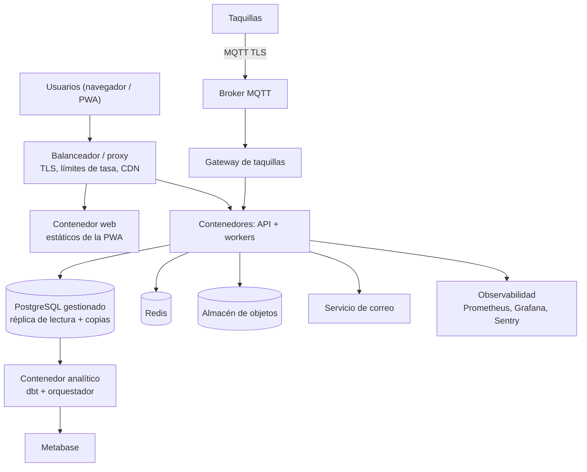

| Aspecto | Decisión |
|---|---|
| Región | **UE** (RGPD) |
| Entornos | `demo` (local), `dev`, `staging` (con datos sintéticos), `prod` |
| Despliegue | Contenedores; **un servidor o PaaS al principio**, orquestador solo si hace falta |
| Front | Estáticos servidos por CDN; el API en el mismo dominio (evita problemas de CORS y de *cookies*) |
| CI/CD | Pruebas, análisis estático y escaneo de dependencias en cada cambio; despliegue automatizado a `staging`; manual y reversible a `prod` |
| Migraciones | Versionadas, compatibles hacia atrás (se despliega código, luego se retira el viejo) |
| Copias de seguridad | Diarias + recuperación a un punto en el tiempo; **simulacro de restauración** trimestral |
| Objetivos de recuperación | RPO ≤ 15 min, RTO ≤ 2 h en horario de mercado (**supuesto**) |
| Datos de prueba | Siempre sintéticos; nunca copias de producción |

---

## 20. Observabilidad, SLOs y modos de fallo

### 20.1 Objetivos de servicio (producción)

| Indicador | Objetivo |
|---|---|
| Disponibilidad de la API (10:00–15:00) | ≥ 99,5 % |
| Latencia de reserva p95 | < 500 ms |
| Retraso de actualización del dashboard p95 | < 3 s |
| Éxito de apertura de taquilla | ≥ 99 % |
| Reconciliación de pagos | 100 % sin diferencias a final de día |

### 20.2 Qué se mide

- **Aplicación:** peticiones, errores, latencias por endpoint; conexiones SSE abiertas.
- **Negocio en vivo:** ofertas activas, pedidos por minuto, denegaciones por motivo.
- **Taquillas:** último contacto, temperaturas, puertas, códigos en espera.
- **Pagos:** webhooks pendientes y reembolsos.

### 20.3 Modos de fallo y respuesta

| Fallo | Efecto | Respuesta |
|---|---|---|
| Pasarela de pago caída | No se pueden crear cobros | Se bloquean nuevas compras con mensaje claro; no se retienen stock ni puntos |
| Webhook de pago retrasado | Pedido en `HELD` más tiempo | Caducidad suave con gracia; si llega tarde y ya caducó, reembolso automático |
| Taquilla sin red | No recibe códigos nuevos | Opera offline con los vigentes; alerta a soporte; no se asignan pedidos nuevos |
| Alarma de temperatura | Producto no seguro | Pedidos afectados a `TEMP_ALARM`, reembolso, compartimento fuera de servicio |
| Fallo del motor de reglas | Compras bloqueadas | Modo seguro: se aplican solo las barandillas municipales y el tope por persona |
| Base de datos principal caída | Parada total | Conmutación a réplica / restauración; la prioridad es no perder el libro de puntos ni los pagos |
| Productor no responde | Pedidos sin preparar | Plazo de preparación; cancelación y penalización automáticas |
| Servicio de correo o push caído | Avisos secundarios no salen | La bandeja de la app sigue funcionando; se reintenta con espera creciente |
| Caída de la conexión SSE | Dashboard sin tiempo real | El cliente reintenta y recarga el estado; no hay pérdida de datos |

---

## 21. Estructura del repositorio y pruebas

### 21.1 Estructura propuesta

```
Mercat-Conect/
├── README.md                   # cómo arrancar la demo en 3 líneas
├── ARQUITECTURA.md
├── LICENSE                     # EUPL-1.2
├── Makefile                    # demo, reset, seed, e2e, test, down
├── docker-compose.yml
├── .env.example
├── docs/
│   ├── adr/                    # registro de decisiones (una por archivo)
│   ├── fuentes/                # justificación y fuentes citadas
│   ├── demo/                   # guion de la demo y capturas
│   └── runbooks/               # qué hacer si falla X
├── apps/
│   ├── api/                    # backend modular
│   │   └── app/{identidad,catalogo,reglas,pedidos,pagos,taquillas,notificaciones,donaciones,envios,reloj,demo}/
│   ├── web/                    # React + Vite + PWA (vecino, productor, gestión, demo)
│   └── locker-gateway/         # MQTT <-> dominio (en la demo, dentro de api)
├── firmware/
│   └── locker-controller/      # controlador local de la taquilla (producción)
├── data/
│   ├── seed/                   # generador determinista de datos inventados
│   ├── sql/                    # esquemas raw/staging/core/marts y pruebas de calidad
│   ├── dbt/                    # (opcional) modelos y linaje
│   └── notebooks/              # exploración y simulación de reglas
├── infra/
│   ├── docker/
│   └── iac/                    # infraestructura como código (producción)
├── packages/
│   └── contracts/              # esquemas de eventos y API compartidos
├── e2e/                        # pruebas Playwright del guion de la demo
└── .github/workflows/
```

### 21.2 Estrategia de pruebas

| Nivel | Qué cubre | Herramientas |
|---|---|---|
| Unitarias | Motor de reglas (tabla de casos), cálculo de puntos, máquinas de estado | pytest |
| Propiedades | "Nunca stock negativo", "nunca gasto > saldo" con entradas aleatorias | Hypothesis |
| Concurrencia | 200 compras simultáneas sobre 10 unidades: exactamente 10 pedidos | Pruebas de carga con base real |
| Integración | Flujo completo con pago y taquilla simulados | Contenedores de prueba |
| Contratos | Eventos y API respetan los esquemas | Validación de esquemas en CI |
| Reloj | Ninguna lógica llama a la hora del sistema | Prueba que rastrea el código |
| Simulación | Reglas y puntos contra datos sintéticos de demanda | Notebooks reproducibles |
| Extremo a extremo | Guion de la demo (escenas 1, 4, 5, 6, 7 y 9) | Playwright |
| Hardware en el bucle | Controlador real contra gateway de prueba | Banco de pruebas (producción) |

**Simulador de demanda** (prioridad alta): sirve a la vez para la demo y para calibrar `allowance`, costes y perfiles antes de un piloto. Es mucho más barato descubrir en simulación que los puntos son demasiado bajos que en un mercado real.

---

## 22. Hoja de ruta

### 22.1 Hackathon: orden de construcción

La regla es **tener cuanto antes un recorrido completo, aunque sea feo**, y mejorarlo después. Cada paso deja la demo en un estado que se puede enseñar.

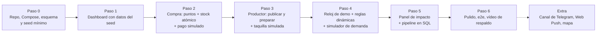

| Paso | Entrega | Cómo se sabe que está hecho |
|---|---|---|
| 0 | `make demo` levanta servicios y datos | Se abre `localhost` y hay datos |
| 1 | Dashboard estilo TGTG, detalle, filtros, SSE | Escena 1 del guion |
| 2 | Registro, verificación simulada, compra con puntos y stock | Escenas 2–5 |
| 3 | Flujo del productor y taquilla virtual | Escenas 6–7 |
| 4 | Reloj, reglas dinámicas, simulador, donación | Escenas 8–9 |
| 5 | Panel de impacto, exportación CSV, calidad de datos | Escena 11 |
| 6 | Pruebas e2e, banner de demo, vídeo, guion ensayado | `make e2e` en verde |

### 22.2 Reparto sugerido (adaptar al tamaño del equipo)

| Rol | Responsabilidad | Pasos principales |
|---|---|---|
| **Backend y dominio** | Esquema, reservas atómicas, puntos, reglas, estados, eventos | 0, 2, 4 |
| **Frontend** | Dashboard, detalle, compra, panel de productor, accesibilidad | 1, 2, 3 |
| **Datos y simulación** | Seed, simulador de demanda, outbox, vistas, panel de impacto | 0, 4, 5 |
| **Taquillas, demo y presentación** | Simulador de taquillas, reloj, guion, pruebas e2e, vídeo, pitch | 3, 4, 6 |

Con menos personas, se prioriza **Debe** de la sección 2 y se recorta **Debería**.

### 22.3 Después del hackathon

| Fase | Entrega | Criterio de salida |
|---|---|---|
| **A. Cimientos** | Marco legal y de datos claro; piloto elegido; petición de datos por mercado (Portal de Transparencia) | Responsable del tratamiento definido; EIPD hecha |
| **B. Piloto sin taquillas** | Verificación de edad real, pasarela real, recogida en el puesto con QR en un mercado | ≥ 10 puestos activos; ≥ 60 % de ofertas con algún pedido; 0 casos de sobreventa |
| **C. Taquillas** | Hardware instalado, gateway real, cadena de frío demostrada | ≥ 99 % de aperturas correctas; 0 pedidos perdidos |
| **D. Escala y datos** | Más mercados, donaciones, datos abiertos publicados, dbt + Metabase | Métricas auditadas; primera publicación abierta |
| **E. Futuro** | Bot de Telegram (avisos), envíos con proveedor privado, modelos de predicción | Aceptación medida y coste por envío asumible |

**Observación importante:** las taquillas son el elemento con **más plazo y más riesgo** (compra, instalación, permisos, sanidad). Se propone **validar primero el interés real sin taquillas** (fase B) mientras se prepara el hardware. Si los puestos no publican o los vecinos no acuden, mejor saberlo antes de invertir en hardware.

---

## 23. Riesgos

| # | Riesgo | Prob. | Impacto | Mitigación |
|---|---|---|---|---|
| R1 | Los puestos no publican (mucho esfuerzo, poco beneficio) | Media | Alto | Publicación en < 30 s, plantillas, "repetir lo de ayer", piloto con puestos motivados; medir el tiempo real |
| R2 | Verificación de edad demasiado pesada y baja la conversión | Alta | Alto | Elegir método con poca fricción (B/A); medir abandono en el embudo |
| R3 | Una app web puede dejar fuera a parte del público (personas mayores) | Alta | Medio | Diseño sencillo y accesible; plan de canal de voz o atención presencial en fases posteriores |
| R4 | Los puntos excluyen a quien más lo necesita | Media | Medio | Simulación y piloto; saldos diferenciados si se aprueba |
| R5 | Fallo de la cadena de frío o incidente alimentario | Baja | **Muy alto** | Sensores, alarmas automáticas, APPCC, seguro, retirada inmediata |
| R6 | Plazos y permisos del hardware | Alta | Alto | Validar primero sin taquillas; elegir proveedor con experiencia |
| R7 | Problemas legales de pagos o de protección de datos | Media | Alto | Proveedor con marketplace, EIPD, asesoría desde la fase A |
| R8 | Canibalización de la venta a precio normal | Media | Medio | Hora mínima de publicación por mercado; seguimiento de ventas |
| R9 | Mantenimiento una vez acabado el hackathon | Alta | Alto | Software abierto, documentación, ADRs, pruebas; identificar un responsable institucional |
| R10 | Productores inflan precios | Baja | Medio | Barandillas y revisión |
| R11 | Abusos organizados (acaparamiento) | Media | Medio | `person_hash`, puntos, detección de patrones |
| R12 | **La demo falla en directo** | Media | Alto | `make reset`, determinismo, e2e, vídeo de respaldo, ensayo del guion, sin dependencia de internet |
| R13 | **Demasiado alcance para el tiempo del hackathon** | Alta | Alto | MoSCoW (sección 2); recorrido completo primero y pulido después |
| R14 | **Se confunde la demo con datos reales** | Media | Medio | Banner permanente, dominios `.test`, no presentar el panel como evidencia |
| R15 | Dependencia de datos sin fuente (el "4 %") | Media | Medio | Usar solo cifras con fuente documentada |

---

## 24. Decisiones abiertas

Ordenadas por impacto. Cada una debería acabar en un registro en `docs/adr/`.

### 24.1 Para el hackathon (resolver ya)

| # | Decisión | Opciones | Recomendación |
|---|---|---|---|
| H1 | Stack | Python (FastAPI) + React / TypeScript completo | Python + React, salvo que el equipo domine más TypeScript |
| H2 | ¿Navegación anónima? | Listado de lectura libre / solo con cuenta | Lectura libre (más fácil de enseñar y de captar) |
| H3 | ¿Mapa en el dashboard? | Sí / no | No, salvo que sobre tiempo |
| H4 | ¿Telegram en el hackathon? | Nada / difusión a un canal / bot de avisos | Difusión a un canal solo si sobra tiempo |
| H5 | Paneles de impacto | Propio en la app / Metabase | Propio; Metabase como extra |
| H6 | Idiomas en la demo | Solo castellano / castellano y valenciano | Con la estructura de traducción desde el principio; valenciano si hay tiempo |

### 24.2 Para producción

| # | Decisión | Opciones | Bloquea |
|---|---|---|---|
| D1 | **¿Participa el Ayuntamiento?** Define verificación de edad (Cl@ve), responsable del tratamiento, permisos de taquillas, cámaras existentes | Sí desde el principio / no | Secciones 7, 13, 18 |
| D2 | Responsable del tratamiento de datos | Ayuntamiento / asociación / entidad nueva | EIPD, contratos |
| D3 | Método de verificación de edad | A (Cl@ve), B (europeo), C (proveedor) | Fase B |
| D4 | Proveedor de pagos con marketplace | Redsys, Stripe u otros | Fase B |
| D5 | Hardware de taquillas | Comercial con API / propio | Fase C, coste |
| D6 | Barandillas de precio | Sin tope / aviso / tope duro | Reglas |
| D7 | Cantidad inicial de puntos y reparto (¿por hogar?) | Por simulación y piloto | Reglas |
| D8 | Pedido a demanda o lotes preporcionados en taquilla | A demanda / lotes / mixto | Flujo del productor |
| D9 | Facturación al comprador | Ticket automático / el productor factura | Pagos |
| D10 | ¿Vía no digital para quien no use la app? | Teléfono de la oficina del mercado / canal de voz / ninguna | Equidad, fase E |
| D11 | Comisión del proyecto | 0 % / cubrir costes | Pagos |
| D12 | App instalable: PWA o envoltorio nativo (por ejemplo, Capacitor) | PWA / nativa | Solo si hace falta tienda de aplicaciones |

---

*Fin del documento. Siguientes pasos recomendados: (1) cerrar H1–H4 y repartir roles; (2) construir el paso 0 (repo, Compose, esquema y seed) para tener algo ejecutable cuanto antes; (3) en paralelo, resolver D1 y D2, que condicionan todo lo que venga después del hackathon.*
